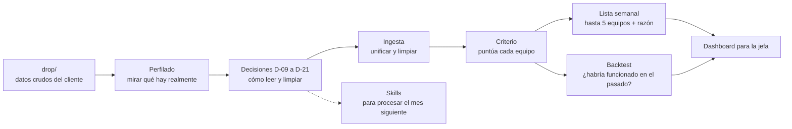
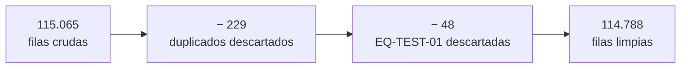
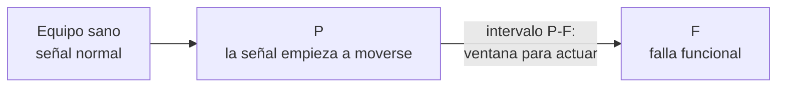
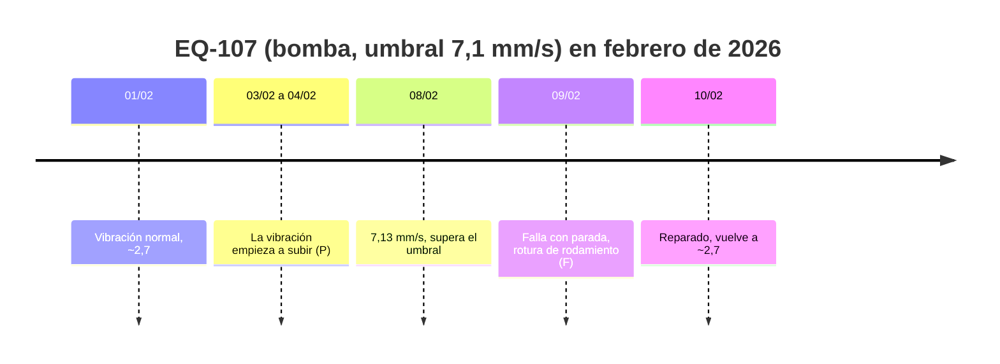
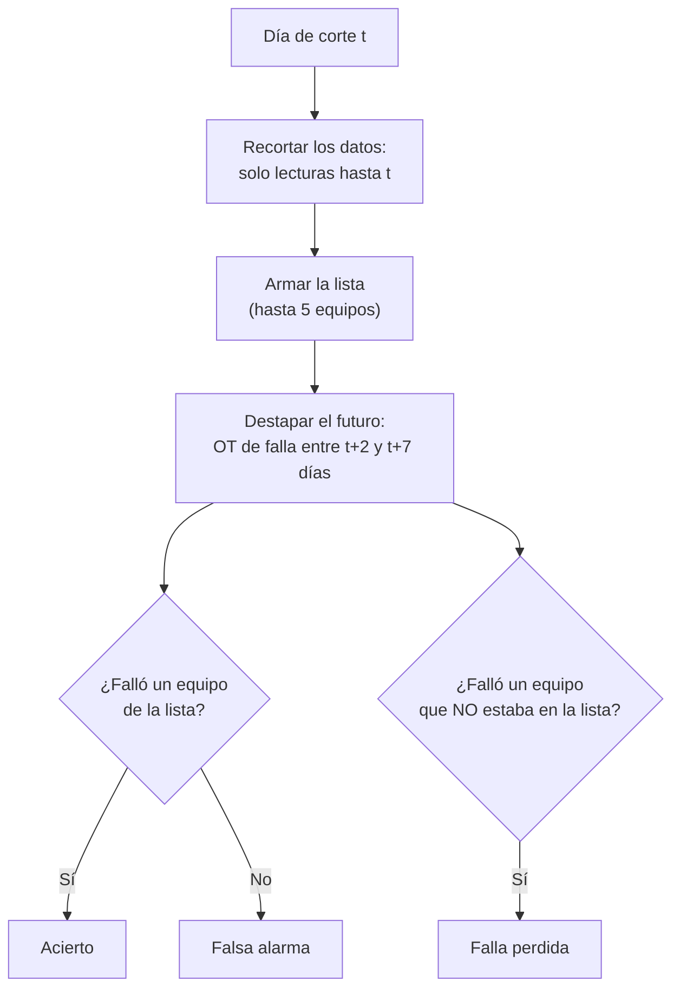
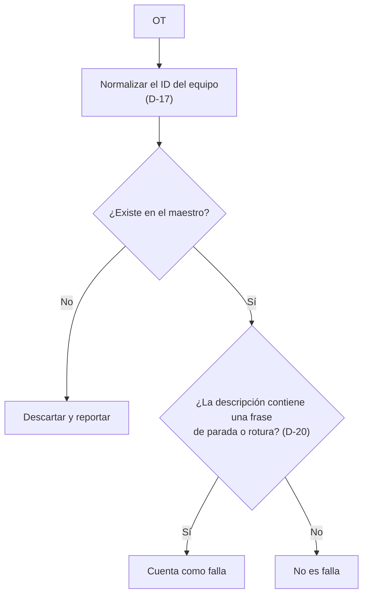

# Guía de conceptos del challenge

Esta guía existe para que puedas leerla de corrido, entender cada pieza del trabajo y explicarla en la charla con el evaluador. Cada concepto trae una definición corta y un ejemplo con **tus datos** (equipos reales de `drop/`). Donde un número es solo un ejemplo para entender el mecanismo, lo dice.

**Cómo ver los diagramas:** están escritos en Mermaid. GitHub los dibuja solo. En VS Code, instalá la extensión *Markdown Preview Mermaid Support* y abrí la vista previa con Cmd+Shift+V.

**Índice**
1. El problema de punta a punta
2. Los datos
3. SQL y DuckDB en 10 piezas
4. Calidad de datos: lo que encontramos en el perfilado
5. Estadística mínima
6. Mantenimiento: qué se mide y por qué (incluye la curva P-F)
7. El criterio: cómo se puntúa un equipo
8. El backtest, paso a paso
9. Ingeniería: pipeline, tests, reproducibilidad, escalado
10. Skills, agentes y uso de IA
11. El dashboard
12. Preguntas probables de la charla
13. Glosario

---

## 1. El problema de punta a punta

La jefa de mantenimiento pregunta: *"¿a cuáles equipos mando a mantenimiento esta semana, y por qué debería creerle a esa lista?"*. Y avisa que el año pasado apagaron un sistema de alertas porque avisaba todo el tiempo.

Entonces hay **dos entregas**: una lista corta de equipos (máximo 5), y la **evidencia** de que esa lista es confiable.



**Dónde estamos:** el perfilado y las decisiones están hechos. Falta construir la ingesta (SPEC R4), el criterio (R5), el backtest (R6), la ventana de anticipación (R7), el dashboard (R8), la documentación (R9) y las skills (R10).

---

## 2. Los datos

Hay tres tipos de archivo en `drop/`:

| Archivo | Qué es | Tamaño |
|---|---|---|
| `lecturas-AAAA-MM-DD.csv` | **Telemetría**: vibración y temperatura de cada equipo cada 15 minutos | 30 archivos, 115.065 filas |
| `equipos.csv` | **Maestro**: los 40 equipos, su tipo, su planta y los umbrales del fabricante | 40 filas |
| `ordenes-de-trabajo.csv` | **OT**: el registro de lo que hizo mantenimiento (revisiones y fallas) | 86 filas |

**Telemetría y serie temporal.** Una *serie temporal* es una secuencia de mediciones ordenadas en el tiempo. Cada equipo tiene dos: una de vibración y una de temperatura. Se lee mirando su forma (si sube, si baja, si es plana), no un valor suelto.

**Frecuencia.** Una lectura cada 15 minutos son 96 por día. Para un equipo en un mes son 2.880, y para los 40 equipos, **115.200** lecturas esperadas. Llegaron 114.788 distintas: faltan 412 (ver sección 4, huecos).

**Clave natural.** Es la combinación de columnas que identifica una lectura sin ambigüedad: aquí, (equipo, momento). Dos filas con la misma clave son "la misma lectura".

**Maestro y umbral.** El *umbral* es el valor del fabricante por encima del cual una lectura se considera alta. Hay uno por tipo de equipo:

| Tipo | Equipos | Vibración (mm/s) | Temperatura (°C) |
|---|---|---|---|
| bomba | 20 | 7,1 | 85 |
| compresor | 13 | 4,5 | 95 |
| turbina | 7 | 2,8 | 110 |

**Orden de trabajo (OT).** Es un registro que cargan los técnicos "como pueden": a veces sin tipo (20 de 86), con el ID del equipo escrito de varias formas (`EQ103`, `eq-117`) y con una descripción en texto libre. Las OT son la **fuente de verdad de las fallas** (asunción del SPEC).

**Vibración y temperatura, en simple.** Un equipo rotativo (bomba, compresor, turbina) gira. Cuando se desgasta un rodamiento o se desbalancea, **vibra más**. Cuando algo se obstruye o se fricciona, **se calienta**. Por eso son las dos señales que miramos.

---

## 3. SQL y DuckDB en 10 piezas

**SQL** es el lenguaje para pedirle datos a una base de tablas. Decís *qué* querés y el motor decide *cómo*. **DuckDB** es un motor que corre en tu computadora, sin servidor, y lee CSV directo. Las 10 piezas que usa el perfilado:

| Pieza | Para qué sirve | Ejemplo con tus datos |
|---|---|---|
| `SELECT … FROM` | Elegir columnas de una tabla | `SELECT eqid, vib FROM c` |
| `WHERE` | Filtrar filas | `WHERE eqid = 'EQ-107'` |
| `GROUP BY` + `count`, `avg`, `median` | Resumir por grupo | cantidad de lecturas por día |
| `ORDER BY` | Ordenar | los equipos por mayor cambio |
| `JOIN` | Cruzar dos tablas por una columna | cruzar lecturas con el maestro para traer el umbral |
| `CASE WHEN` | Un "si… entonces…" | si la unidad es `F`, convertir; si no, dejar |
| `CAST` / `TRY_CAST` | Cambiar el tipo de un valor (texto a número). `TRY_` devuelve NULL en vez de fallar | detectar textos que no son números |
| `coalesce(a, b)` | El primer valor que no sea NULL | unir `equipment_id` y `asset_id` en una columna |
| `WITH x AS (…)` | Una tabla temporal con nombre (CTE) | armar un resumen por equipo y después trabajar sobre él |
| Función de ventana `lag() OVER (…)` | Mirar la fila anterior | la lectura anterior de ese equipo, para medir huecos |

**Propios de DuckDB** (no son SQL estándar): `read_csv(...)`, `union_by_name`, `all_varchar`. Si algún día se cambia de motor, esas partes hay que reescribirlas.

**Una vista (VIEW)** es una consulta con nombre guardada. No copia datos: cada vez que se usa, vuelve a leer los CSV. Por eso el perfilado define `raw`, `l` y `c` una sola vez.

**Un ejemplo completo, leído línea por línea**, para detectar un hueco de lecturas:

```sql
WITH g AS (                                                       -- 1
  SELECT eqid, ts,
         ts - lag(ts) OVER (PARTITION BY eqid ORDER BY ts) AS gap -- 2
  FROM (SELECT DISTINCT eqid, ts FROM c)                          -- 3
)
SELECT eqid, ts, gap FROM g WHERE gap > INTERVAL 15 MINUTE;       -- 4
```

1. Se arma una tabla temporal `g`.
2. Para cada lectura se resta la lectura **anterior del mismo equipo** (`PARTITION BY eqid` agrupa por equipo y `ORDER BY ts` las ordena en el tiempo). El resultado es el tiempo entre dos lecturas consecutivas.
3. `DISTINCT` evita contar dos veces las lecturas duplicadas.
4. Se queda con las que están separadas por más de 15 minutos: esos son los huecos.

**Dos opciones de lectura que explican varias decisiones:**
- `all_varchar=true` lee todo como **texto**, para que DuckDB no adivine tipos y esconda basura. Después se convierte con `TRY_CAST` y se cuenta lo que no convierte.
- `union_by_name=true` junta los 30 archivos alineando columnas por **nombre**, no por posición. Es lo que permite leer juntos dos formatos con encabezados distintos.

---

## 4. Calidad de datos: lo que encontramos en el perfilado

El **perfilado** es mirar los datos crudos antes de tocarlos: estructura, calidad, distribución. Todo está en `docs/perfilado.md`. Acá va cada problema, con una idea simple y una decisión.

### 4.1 Dos formatos de archivo (H-01, D-09)

El sistema de captura cambió el 11/02. Los archivos viejos y los nuevos nombran distinto las mismas cosas:

| Concepto | Viejo (hasta 10/02) | Nuevo (desde 11/02) |
|---|---|---|
| Equipo | `equipment_id` | `asset_id` |
| Momento | `ts` | `timestamp` |
| Vibración | `vibracion_mm_s` | `vibration_mm_s` |
| Temperatura | `temperatura_c` | `temp` |
| Unidad | *(no existe)* | `unidad_temp` |

`coalesce(equipment_id, asset_id)` resuelve las dos columnas en una. **Decisión D-09:** si aparece un encabezado desconocido, el pipeline **se detiene con un error**. Es mejor frenar que producir datos vacíos sin que nadie lo note.

### 4.2 Duplicados (H-03, D-10)

El sistema viejo repetía lecturas. Hay dos tipos:
- **Exacto:** misma clave y mismos valores (5 casos).
- **Conflictivo:** misma clave pero valores distintos (224 casos).

Ejemplo real: EQ-104, 06/02 03:00 → vibración 3,192 en una fila y 3,181 en la otra; temperatura 55,51 en ambas. **Decisión D-10:** quedarse con la de **mayor vibración**. Es determinista, usa un valor que existe en el dato crudo y no oculta un pico. No se promedia porque eso **inventaría** un valor.

### 4.3 Unidades (H-04, D-12)

El sistema nuevo mezcla °C y °F: 11.400 filas vienen en °F, repartidas en los 40 equipos. Un valor de 149 °F es 65 °C: normal. Pero si se leyera como 149 °C, parecería un equipo a punto de explotar.

Conversión: **°C = (°F − 32) × 5 / 9**. Ejemplo: (149 − 32) × 5 / 9 = 65 °C.

Sin convertir, el 14,92 % de las lecturas nuevas superaría el umbral de temperatura. Es **exactamente el tipo de alerta que avisa todo el tiempo**. **Decisión D-12:** convertir según `unidad_temp`, y detener el pipeline si aparece una unidad que no sea `C` ni `F`.

### 4.4 Zona horaria (H-07, D-13)

Los timestamps no dicen en qué zona están. La temperatura de una planta sube de tarde y baja de madrugada. En el sistema viejo el máximo diario cae a las 14:30; en el nuevo, a las 17:30: **3 horas de corrimiento**. Mauro confirmó que el viejo y las OT están en hora de planta; del nuevo no sabe.

**Decisión D-13:** no corregir el dato. Corregirlo crearía 484 lecturas repetidas el 10/02 y un hueco de 3 horas al final del mes, y se apoya en una inferencia sin confirmar. El desfase queda como parámetro configurable (0 por defecto).

### 4.5 Huecos (H-08, D-14)

Una **lectura ausente no es un cero**: es ausencia de dato. Faltan 412 lecturas. EQ-110 deja de reportar el 28/02 y no vuelve; cinco equipos tienen un hueco de ~8 horas, el mismo día de su falla (el equipo estaba parado). **Decisión D-14:** no rellenar con interpolación ni con ceros (se inventaría una señal); avisar con "sin telemetría reciente".

### 4.6 Equipos fuera del maestro (H-06, D-11)

Hay un equipo `EQ-TEST-01` (48 filas) que no está en `equipos.csv`. **Decisión D-11:** se conservan solo los IDs del maestro (*lista blanca*) y se reporta cuántas filas se descartaron. Se excluye porque **no está en el maestro**, no por su temperatura.

### 4.7 Cuadre de filas

Un control simple de integridad: **todo lo que entra tiene que salir contado**.



El test de SPEC R4(a) comprueba que *filas crudas = limpias + duplicados + inválidas*.

### 4.8 Sensores que mienten (H-10, D-16)

Cuando se cambió el sensor de vibración de EQ-209 (14/02) y de EQ-118 (20/02), la vibración cayó de ~2 a **0,08**. Nadie se arregló: el sensor nuevo mide en otra escala o está mal calibrado. EQ-209 falló el 27/02 con el monitoreo en 0,08. Una señal "perfecta" puede ser un **sensor ciego**. **Decisión D-16:** detectarlo y tratarlo como un motivo de revisión propio.

---

## 5. Estadística mínima

**Media y mediana.** La *media* suma todo y divide. La *mediana* es el valor del medio al ordenar. Ejemplo: vibraciones 2,5 — 2,6 — 2,6 — 2,7 — 32,8. La media es 8,2 (arrastrada por el pico); la mediana es 2,6. En tus datos hay 16 lecturas de más de 10 mm/s (máximo 32,8) repartidas de a 1 o 2 en 12 equipos: picos aislados. Por eso se usa **mediana**.

**Percentil.** El percentil 99,9 es el valor por debajo del cual está el 99,9 % de las lecturas. En tus datos es 83,1 °C: casi todas las lecturas de temperatura están por debajo.

**Ruido y señal.** El *ruido* es la variación normal sin significado. La *señal* es el cambio que sí significa algo. Un buen límite está **por encima del ruido y por debajo de la señal que querés detectar**. Así se fijó la tolerancia de **D-15**: el ruido (mediana del cambio entre equipos) es −0,008 %, el error que se quiere atrapar (no convertir °F) es +1,24 %, y se eligió ±0,5 % entre ambos.

**Muestras chicas.** Hay 5 fallas en el mes. Con 5 fallas, **un acierto más o menos mueve el recall 20 puntos** (1 de 5 = 20 %). Un porcentaje alto con pocas fallas es poca evidencia. Por eso el SPEC pide declarar la limitación, y la meta se expresará en **conteos** (por ejemplo "3 de 5") y no solo en porcentajes.

**El azar como referencia.** Si elegís 5 equipos al azar de 40, cada uno tiene una probabilidad de 5/40 = 12,5 % de entrar. Aproximando: con 5 fallas repartidas en ~30 días y una ventana de acierto de 6 días, se espera que falle ~1 equipo por ventana (5 × 6 / 30). Una lista al azar acertaría en promedio ~0,12 equipos por día y tendría una precisión cercana al 2,5 %. Es una cuenta aproximada, para ubicar de qué orden es la referencia.

---

## 6. Mantenimiento: qué se mide y por qué

**Tres estrategias de mantenimiento:**

| Estrategia | Cuándo se interviene | Problema |
|---|---|---|
| **Correctivo** | Cuando el equipo ya falló | Paradas imprevistas, costosas |
| **Preventivo** | Según calendario, con o sin necesidad | Se interviene equipos sanos |
| **Predictivo** | Cuando los datos indican que se está degradando | Requiere medir y un criterio confiable (**es lo que construimos**) |

**Falla funcional.** El equipo deja de cumplir su función: se para, se dispara una protección. En las OT: "Parada no programada. Rotura de rodamiento" (EQ-107).

### La curva P-F

Una falla no ocurre de golpe: el equipo se degrada de a poco.
- **P** (*potencial falla*): el momento en que la degradación **empieza a notarse** en la señal.
- **F** (*falla funcional*): el momento en que **falla de verdad**.
- **Intervalo P-F:** el tiempo entre P y F. Es el margen que hay para actuar.



Un intervalo largo permite programar la visita y conseguir repuestos. Un intervalo de horas no deja tiempo para una lista **semanal**. Por eso SPEC R7 lo estima con datos.

**Un ejemplo con tus datos.** EQ-107 (bomba), promedios diarios de vibración:



Aquí el intervalo P-F es de unos 5 a 6 días. Y la OT lo confirma: "el operador comenta que hacía ruido hace unos días".

**Lectura preliminar de las fallas del mes** (a partir de los promedios diarios; no es el resultado final de R7):

| Equipo | Qué se ve antes de la falla | Anticipación aproximada |
|---|---|---|
| EQ-107 (bomba) | Vibración sube desde el 03/02–04/02; falla el 09/02 | ~5 a 6 días |
| EQ-112 (turbina) | Vibración sube desde el 17/02 (1,74 a 1,89); falla el 22/02 | ~5 días |
| EQ-214 (compresor) | Temperatura sube desde el 12/02 (69 a 89 °C); falla el 16/02 | ~4 días |
| EQ-116 (bomba) | Sin cambio visible; OT dice "sin aviso previo" | ~0 (no hay señal) |
| EQ-209 (compresor) | Sensor ciego desde el 14/02; sin señal confiable | No se puede saber |

Es una información valiosa: tres de las cinco fallas avisan con 4 a 6 días, y dos no. Eso condiciona qué puede lograr cualquier criterio: **no se puede anticipar lo que no avisa**. R7 pide estimar el rango con datos y decir "no estimable" si hay menos de 3 fallas con señal. Con 3, queda justo en el borde.

**Fatiga de alertas.** Es cuando un sistema avisa tanto que la gente deja de mirarlo. Es lo que le pasó al cliente. Por eso la métrica clave no es solo "atrapar fallas" sino **atraparlas sin llenar de falsas alarmas**.

---

## 7. El criterio: cómo se puntúa un equipo

El **criterio** es la regla que, con los datos hasta un día, decide qué equipos entran a la lista. **Todavía no está diseñado**; se hace en el paso siguiente. Los conceptos que hay que tener claros:

**Umbral fijo contra línea base.**
- *Umbral fijo*: el valor del fabricante, el mismo para todos los equipos de un tipo.
- *Línea base*: el nivel **normal de cada equipo**. Una alerta por línea base mira cuánto se aleja un equipo de *su propia* normalidad.

Con EQ-112, una turbina cuyo umbral es 2,8 mm/s:

| Día | Vibración | ¿Supera el umbral (2,8)? | Cambio respecto de su línea base (1,74) |
|---|---|---|---|
| 01/02 a 16/02 | ~1,74 | No | 0 % |
| 17/02 | 1,89 | No | +9 % |
| 19/02 | 2,23 | No | +28 % |
| 21/02 | 2,75 | No (el promedio diario) | +58 % |
| 22/02 | falla | — | — |

El umbral recién se cruza en lecturas sueltas de los últimos días, y la línea base ya mostraba un cambio claro el 19/02 (+28 %). **Esta es la razón de ser del criterio propio**: ver antes lo que el umbral fijo ve tarde. Por eso el umbral del fabricante se usa solo como **referencia ingenua** del backtest (D-21).

**Reglas explicables contra modelo de machine learning.** Un modelo (ML) aprende patrones solo; con 5 fallas **sobreajusta** (memoriza esas 5 en vez de aprender una regla general) y no puede explicar por qué eligió un equipo. Una regla explicable ("la vibración subió 28 % sobre su normal en 3 días") sí se puede defender ante la jefa (D-06).

**Puntaje y razón.** Cada equipo recibe un puntaje y una razón en texto. El SPEC (R5) exige que la razón cite evidencia **comprobable** con una consulta independiente sobre los datos crudos.

**Ventana móvil.** En vez de un valor suelto, se mira un tramo reciente (por ejemplo, los últimos 3 días) para no reaccionar a un pico aislado.

---

## 8. El backtest, paso a paso

El **backtest** es un simulacro con el pasado. Ya sabemos qué equipos fallaron (las OT). Entonces fingimos no saberlo, aplicamos el criterio como si estuviéramos en cada día del mes, y comparamos con lo que realmente pasó. Es como probar un pronóstico del tiempo: no esperás un mes, tomás el pronóstico de hace 10 días y lo comparás con lo que llovió.



**La lista** es la de hasta 5 equipos para mandar a mantenimiento, calculada **solo con datos hasta el día de corte**.

**Ejemplo ilustrativo** (los resultados son inventados, para entender el mecanismo). Corte el 20/02. Suponé que el criterio arma la lista: EQ-115, EQ-102, EQ-209, EQ-118 y EQ-219. Se destapan las OT de falla entre el 22/02 y el 27/02:

| Equipo | ¿Falló en 22–27/02? | Resultado |
|---|---|---|
| EQ-209 | Sí, el 27/02 | **Acierto** |
| EQ-112 | Sí, el 22/02, pero no estaba en la lista | **Falla perdida** |
| EQ-115, EQ-102, EQ-118, EQ-219 | No fallaron en ese plazo | **Falsas alarmas** |

Se repite para cada corte (01/02, 02/02… 23/02) y se juntan los resultados.

**Acierto con ventana de 2 a 7 días (D-08).** Un equipo marcado el día t cuenta como acierto si falla entre t+2 y t+7. No se cuenta el día siguiente porque marcar un equipo que falla mañana no deja tiempo de programar la visita.

**La matriz de resultados:**

| | Falló en la ventana | No falló |
|---|---|---|
| **Estaba en la lista** | Acierto (verdadero positivo) | Falsa alarma (falso positivo) |
| **No estaba en la lista** | Falla perdida (falso negativo) | Correcto (verdadero negativo) |

**Las medidas:**

| Medida | Qué responde | Cálculo |
|---|---|---|
| **Precisión** | De los equipos marcados, ¿cuántos eran fallas reales? | aciertos ÷ equipos marcados |
| **Recall** (cobertura) | De las fallas que ocurrieron, ¿cuántas atrapamos? | fallas atrapadas ÷ fallas totales |
| **Falsas alarmas por semana** | ¿Cuánto ruido generamos? (la fatiga de alertas) | equipos marcados que no fallaron, por semana |

Con ejemplo: si en un período marcamos 10 equipos, 3 eran fallas y hubo 5 fallas totales, la precisión es 3/10 = 30 % y el recall 3/5 = 60 %. Hay un **compromiso**: marcar más equipos sube el recall pero baja la precisión y aumenta las falsas alarmas. La lista limitada a 5 es parte de ese compromiso.

**Referencias.** Un resultado suelto no dice si es bueno. Se compara contra dos referencias (R6):
1. **Elegir 5 equipos al azar**: si no se supera esto, el criterio no sirve.
2. **Alerta ingenua por umbral del fabricante**: imita al sistema apagado. Se quiere generar menos falsas alarmas que ella.

**Fuga de información (*data leakage*).** Es hacer trampa sin querer: que la lista de un día use datos **posteriores** a ese día. Ejemplos:
- Calcular la línea base de un equipo con **todo el mes**, que incluye el futuro.
- Usar la OT de la falla para decidir que ese equipo entra a la lista.

El **test anti-fuga**: la lista calculada con todos los datos tiene que ser idéntica a la calculada con los datos recortados a antes del corte. Si difieren, hay fuga.

**Qué cortes se pueden evaluar (D-19).** Los datos terminan el 02/03. Un corte tardío, como el 28/02, tiene una ventana que se pasa del final: si un equipo marcado no falló hasta el 02/03, no se sabe si fallará después. Por eso el backtest usa solo los cortes del **01/02 al 23/02**. La lista de "esta semana" se calcula igual el 02/03, pero sin evaluación propia, y el informe lo dice.

**Cortes que se solapan.** Los cortes diarios no son independientes: el corte del 20/02 y el del 21/02 miran casi las mismas fallas. Con 5 fallas, el resultado es **evidencia modesta**, y hay que decirlo (D-05).

**Qué cuenta como falla (D-20).** Una OT cuya descripción contiene una frase de parada o rotura de una lista configurable. El campo `tipo` no se usa, porque falla en los dos sentidos.



Ejemplo: "Equipo detenido por falla de rodamiento" coincide con "detenido": es falla. "Revisión de cableado, sin falla" no coincide con ninguna frase: no es falla.

---

## 9. Ingeniería: pipeline, tests, reproducibilidad, escalado

**Pipeline.** Una cadena de pasos automáticos que transforma los datos crudos en el resultado final. Se corre con **un solo comando** (R1), por ejemplo `make run`.

**Offline.** El pipeline no llama a ningún servicio externo ni a ningún LLM. Funciona sin internet (`uv sync` necesita red una sola vez, para bajar las librerías).

**Reproducibilidad y determinismo.** Dos corridas con los mismos datos tienen que dar **exactamente** el mismo resultado. Se comprueba comparando el `shasum` (una "huella digital" del archivo) de `lista-semanal.csv` en dos corridas. Por eso la deduplicación (D-10) elige por el valor de vibración y no por el orden de lectura, que puede variar.

**Datos crudos intocables.** `drop/` es solo lectura (R2). Todo lo derivado va a `salida/`. Así la evidencia siempre se puede rehacer desde cero.

**Parámetros en un archivo versionado.** Los valores que ajustan el comportamiento (la lista de frases de falla, el desfase horario, las tolerancias) viven en un archivo de configuración dentro de git, no escritos en el código. Cambiarlos deja historial.

**Tests automáticos y manuales.** El SPEC etiqueta cada requisito como [AUTO] (lo verifica `make test`), [MANUAL] (lo revisa una persona) o [PENDIENTE]. Ejemplos de [AUTO]: el cuadre de filas, que no haya duplicados, el test anti-fuga, que `drop/` no cambió.

**Git y un paso, un commit.** Cada paso del trabajo se cierra con un commit. `DECISIONES.md` guarda las decisiones con su evidencia; `AI-LOG.md` guarda los errores de la IA y cómo se detectaron.

**Escalado (500 equipos reportando cada minuto).**

| | Hoy | Escenario |
|---|---|---|
| Equipos | 40 | 500 |
| Lecturas por equipo por día | 96 (cada 15 min) | 1.440 (cada minuto) |
| Lecturas por día | 3.840 | 720.000 |
| Factor | | **× 187,5** |

Hoy todo entra en memoria de una laptop (~115.000 lecturas). A 720.000 por día, un mes serían ~21,6 millones de filas. Lo que cambia: guardar en un formato columnar (como Parquet) particionado por día, procesar de forma incremental (solo el día nuevo) en vez de releer todo, y pasar de un proceso por lotes a uno en continuo si se quisieran alertas en tiempo real. Es el contenido de la sección "Escalado" de `DECISIONES.md`.

---

## 10. Skills, agentes y uso de IA

**Skill.** Un archivo `SKILL.md` con instrucciones reutilizables para un agente de IA. Tiene un nombre, una descripción de cuándo usarla y los pasos. En este proyecto habrá dos: una para **leer un drop** (los dos formatos, °F, duplicados) y otra para **procesar un drop completo**.

**La prueba de las skills (R10).** Con el drop del mes que viene, **otra persona con un agente nuevo, que no tiene el contexto de esta conversación**, tiene que poder procesarlo usando solo las skills. Si lo necesita, la skill está incompleta. Un detalle honesto: si el drop de prueba es una copia de este con fechas corridas, no prueba un formato nuevo, y hay que decirlo.

**Agente.** Una definición de un asistente con un rol fijo y herramientas limitadas. Una idea opcional es un "analista" que responda preguntas sobre el resultado. No es obligatorio.

**IA en el pipeline contra IA para construirlo.** El pipeline **no** llama a ningún LLM al correr. La IA se usó para construirlo, y los errores que cometió están registrados en `AI-LOG.md`. Es lo que el evaluador quiere conversar: cómo se trabajó con IA, dónde hubo que corregirla y cómo se verificó.

---

## 11. El dashboard

El dashboard es para la jefa de mantenimiento, no para un ingeniero de datos. En **un minuto** tiene que responder tres preguntas:
1. **¿Qué equipos?** La lista de hasta 5.
2. **¿Por qué?** La razón de cada uno, en palabras y con evidencia visible.
3. **¿Puedo creerle?** La evidencia del backtest, con su limitación declarada.

**Reglas simples de visualización** (de la guía de dataviz):
- Un gráfico, una idea: el título dice la conclusión.
- Un solo eje vertical; nada de dos escalas en un mismo gráfico.
- El color identifica algo, no decora; no se depende del color solo.
- Los números del dashboard coinciden con `backtest.csv` (un test lo comprueba).
- Es un solo archivo HTML, sin recursos externos.

---

## 12. Preguntas probables de la charla

| Pregunta | Respuesta corta |
|---|---|
| ¿Por qué no usaron machine learning? | Con ~5 fallas un modelo sobreajusta y no explica sus decisiones. Las reglas se defienden ante la jefa (D-06). |
| ¿Cómo saben que la lista es confiable? | Con un backtest diario sin fuga, comparado contra el azar y contra una alerta por umbral, y con un test anti-fuga. |
| ¿Qué limita el backtest? | Hay solo 5 fallas en el mes; los cortes diarios se solapan; no hay un tramo reservado para validar. Está declarado. |
| ¿Qué problemas tenían los datos? | Dos formatos, °F mezclados, duplicados que difieren, zona horaria sin documentar, huecos, un equipo fantasma y sensores que miden mal. |
| ¿Por qué no corrigieron las 3 horas de desfase? | Se apoyaba en una inferencia sin confirmar y creaba 484 conflictos y un hueco final (D-13). |
| ¿Por qué no rellenaron los huecos? | Un hueco es información: el equipo estaba parado. Rellenar inventa una señal (D-14). |
| ¿Cómo definieron "falla"? | Por frases de parada o rotura en la descripción de la OT, no por el campo tipo, que falla en los dos sentidos (D-20). |
| ¿Dónde corrigieron a la IA? | En `AI-LOG.md`: por ejemplo, afirmó un total de huecos sin cuadrarlo contra una cuenta independiente (412, no 220). |
| ¿Qué cambia con 500 equipos cada minuto? | 720.000 lecturas por día (×187,5): formato columnar, particionado, proceso incremental (sección Escalado). |
| ¿Qué harían con más tiempo? | Confirmar con el cliente la zona horaria y la calibración del sensor nuevo, y reservar un tramo de datos para validar de verdad. |

---

## 13. Glosario

| Término | Significado |
|---|---|
| **Acierto** | Un equipo de la lista que falla entre 2 y 7 días después del corte |
| **Backtest** | Simulacro con datos pasados: aplicar el criterio día por día y comparar con lo que ocurrió |
| **Baseline / línea base** | El nivel normal de un equipo; sirve para medir cuánto se aleja |
| **Clave natural** | Columnas que identifican una lectura: (equipo, momento) |
| **Corte** | El día en que se "congela" el conocimiento en un backtest |
| **CTE** | `WITH x AS (…)`: una tabla temporal con nombre dentro de una consulta |
| **Cuadre** | Comprobar que lo que entra es igual a lo que sale, contado |
| **Determinista** | Que da siempre el mismo resultado con los mismos datos |
| **Duplicado exacto / conflictivo** | Misma clave con mismos valores / con valores distintos |
| **Falla funcional (F)** | El equipo deja de cumplir su función |
| **Falsa alarma** | Un equipo marcado que no falló |
| **Fatiga de alertas** | Perder atención porque un sistema avisa demasiado |
| **Fuga (leakage)** | Usar datos posteriores al corte para decidir; invalida el backtest |
| **Intervalo P-F** | Tiempo entre que la degradación se nota (P) y la falla (F) |
| **Lista blanca** | Aceptar solo lo que está en una lista conocida (por ejemplo, los IDs del maestro) |
| **Mediana** | El valor del medio al ordenar; no la mueven los picos |
| **NULL** | Sin dato (no es cero ni vacío) |
| **OT** | Orden de trabajo del sistema de mantenimiento |
| **Perfilado** | Mirar datos crudos para conocer su estructura y calidad antes de tocarlos |
| **Precisión** | De lo marcado, qué parte era falla real |
| **Recall** | De las fallas reales, qué parte se atrapó |
| **Reproducible** | Que otra persona, o la misma otra vez, obtiene el mismo resultado |
| **Serie temporal** | Mediciones ordenadas en el tiempo |
| **Sobreajuste** | Cuando un modelo memoriza los casos conocidos y no generaliza |
| **Umbral** | Valor del fabricante sobre el cual una lectura se considera alta |
| **Vista (VIEW)** | Consulta con nombre guardada; no copia datos |
| **Ventana de acierto** | El tramo (2 a 7 días después del corte) donde debe ocurrir la falla |

---

*Los números de esta guía vienen de `docs/perfilado.md` y `DECISIONES.md`. La lectura preliminar de las fallas de la sección 6 sale de promedios diarios y se afina en el paso de la ventana P-F (R7).*
