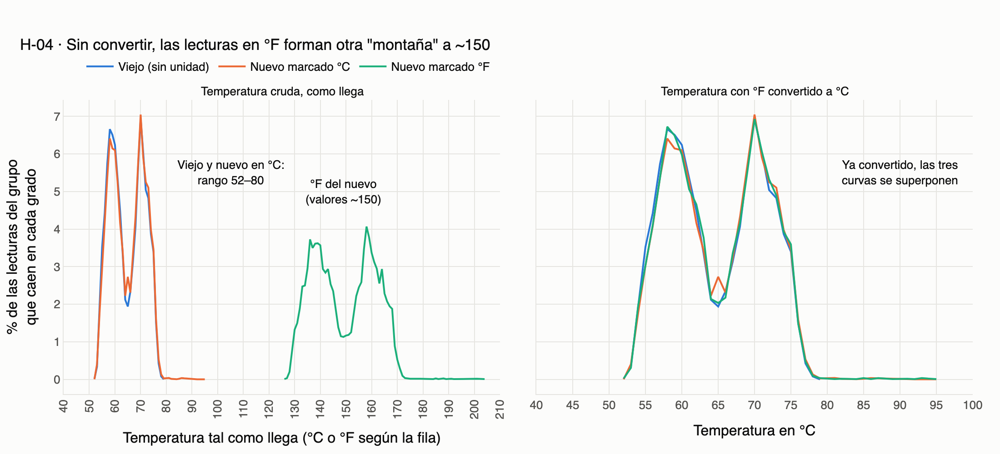
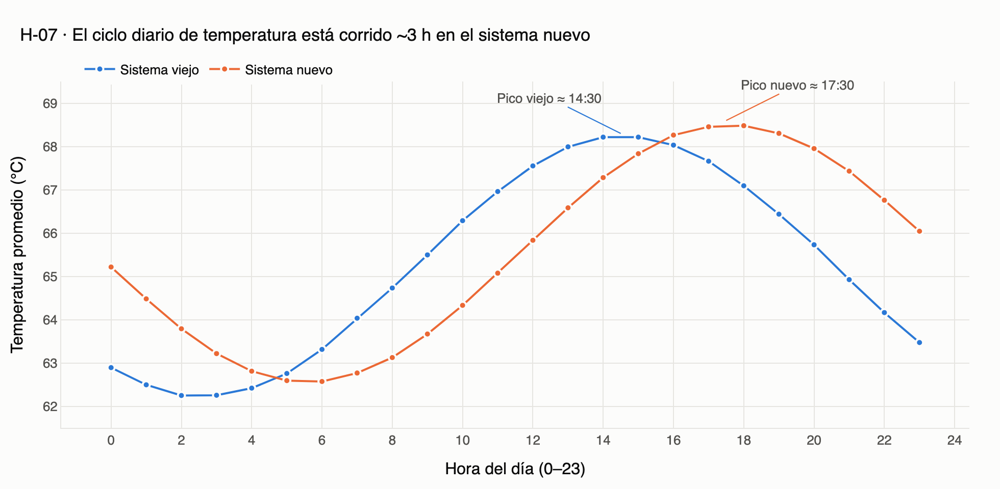
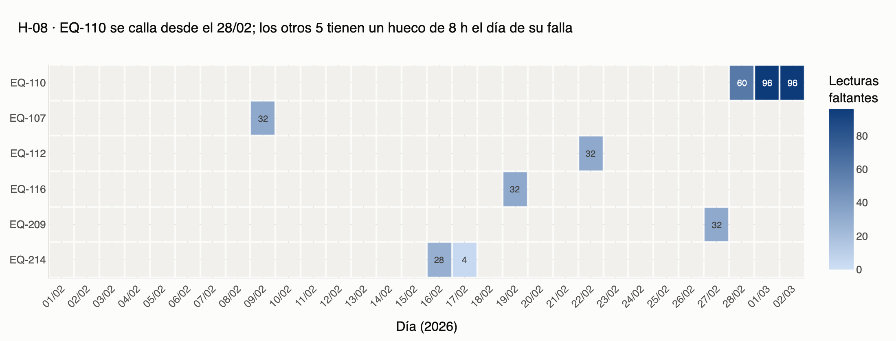
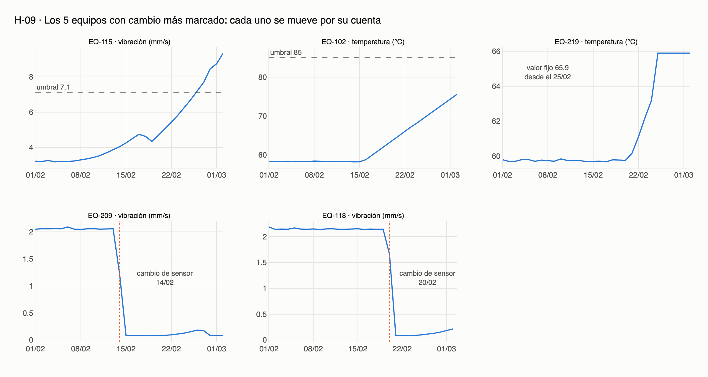

# Perfilado de `drop/` (paso 03)

- **Fecha:** 2026-11-16 · **Motor:** DuckDB 2.0.0 · **Fuente:** `drop/` en solo lectura (nada se modificó).
- **Para quién es este documento:** para sentarse a leerlo de punta a punta y entender qué hay en los datos, por qué cada consulta es como es, qué hay que decidir y qué conviene decidir.
- **Qué es un perfilado:** el *perfilado de datos* (data profiling) es la inspección sistemática de datos crudos —estructura, calidad, distribución— **antes** de transformarlos. Aquí solo se observa. Las decisiones se toman después y se registran en `DECISIONES.md`, citando el número de hallazgo (H-NN).

**Gráficos:** las imágenes de `docs/graficos/` (H-04, H-07, H-08, H-09) se regeneran con `uv run python docs/graficos/generar_graficos.py`. El script lee `drop/` en solo lectura y necesita Google Chrome instalado (variable `CHROME_BIN` si no está en la ruta de macOS por defecto).

## Cómo está organizado cada hallazgo

Cada hallazgo (H-NN) tiene siempre las mismas partes, en este orden:

1. **Qué buscábamos:** la pregunta, en lenguaje común.
2. **Consulta:** el SQL exacto que se ejecutó, seguido de **Cómo leer la consulta** (qué hace cada línea).
3. **Resultado:** las cifras que devolvió.
4. **Qué significa:** la interpretación.
5. **Decisión a tomar:** opciones posibles con pro y contra, y una **Recomendación**. Son propuestas para que las confirmes; nada de esto está decidido todavía.

## Glosario mínimo

| Término | Qué significa |
|---|---|
| **Crudo** | Dato tal como llegó del cliente, sin limpiar. |
| **Clave natural** | Las columnas que identifican una lectura sin ambigüedad: aquí (equipo, momento). Dos filas con la misma clave son la "misma lectura". |
| **Duplicado exacto / conflictivo** | Exacto: misma clave y mismos valores. Conflictivo: misma clave pero valores distintos. |
| **Mediana vs. media** | La media suma todo y divide, así que un pico aislado la arrastra. La mediana es el valor del medio al ordenar, y un pico no la mueve. Para datos con picos, la mediana es más fiable. |
| **NULL** | "Sin dato". No es cero ni texto vacío: es ausencia. |
| **Umbral** | Valor del fabricante por encima del cual la lectura se considera alta. |
| **OT** | Orden de trabajo del sistema de mantenimiento. |

---

## Preparación: las vistas que usan todas las consultas

Una *vista* (VIEW) es una consulta con nombre guardada, que luego se usa como si fuera una tabla. No copia datos: cada vez que se usa, vuelve a leer los CSV. Se definen cuatro:

```sql
CREATE VIEW raw AS SELECT * FROM read_csv('drop/lecturas-*.csv',
    union_by_name=true, filename=true, all_varchar=true);
CREATE VIEW eq  AS SELECT * FROM read_csv('drop/equipos.csv', all_varchar=true);
CREATE VIEW ot  AS SELECT * FROM read_csv('drop/ordenes-de-trabajo.csv', all_varchar=true);

CREATE VIEW l AS SELECT filename, (equipment_id IS NOT NULL) viejo,
    coalesce(equipment_id, asset_id) eqid, coalesce(ts, timestamp) ts_txt,
    coalesce(vibracion_mm_s, vibration_mm_s) vib_txt,
    coalesce(temperatura_c, temp) temp_txt, unidad_temp
  FROM raw;

CREATE VIEW c AS SELECT filename, viejo, eqid, CAST(ts_txt AS TIMESTAMP) ts,
    CAST(vib_txt AS DOUBLE) vib,
    CASE WHEN unidad_temp='F' THEN (CAST(temp_txt AS DOUBLE)-32)*5/9
         ELSE CAST(temp_txt AS DOUBLE) END temp_c,
    CAST(temp_txt AS DOUBLE) temp_raw, unidad_temp
  FROM l WHERE eqid <> 'EQ-TEST-01';
```

**Cómo leerlas, opción por opción:**

- `read_csv('drop/lecturas-*.csv', ...)`: el `*` lee los 30 archivos diarios de una vez, como si fueran uno solo.
- `all_varchar=true`: lee **todas las columnas como texto**, sin dejar que DuckDB adivine tipos. Si adivinara, podría esconder basura (por ejemplo un `"N/A"` en una columna numérica) o fallar sin avisar. Leído como texto, la basura se ve y se cuenta con `TRY_CAST`, que devuelve NULL cuando no puede convertir.
- `union_by_name=true`: une los archivos alineando las columnas **por nombre**, no por posición. Esto es clave porque los dos formatos tienen **encabezados distintos**:

  | Concepto | Formato viejo (hasta 10/02) | Formato nuevo (desde 11/02) |
  |---|---|---|
  | Equipo | `equipment_id` | `asset_id` |
  | Momento | `ts` | `timestamp` |
  | Vibración | `vibracion_mm_s` | `vibration_mm_s` |
  | Temperatura | `temperatura_c` | `temp` |
  | Unidad | *(no existe)* | `unidad_temp` |

  Con `union_by_name`, el resultado tiene **las 9 columnas**; en las filas del archivo viejo, las columnas del nuevo (`asset_id`, `timestamp`, etc.) quedan en NULL, y al revés.
- `filename=true`: agrega una columna `filename` con el archivo de origen de cada fila. Sirve para saber a qué día pertenece cada lectura.
- Vista `l`: unifica los nombres con `coalesce(a, b)`, que devuelve el primer valor que **no** sea NULL. Como cada fila viene de un solo formato, uno de los dos siempre es NULL y el otro tiene el dato. Por eso `coalesce(equipment_id, asset_id)` da el ID del equipo sea cual sea el formato. La columna `viejo` es `true` cuando la fila trae `equipment_id`.
- Vista `c`: ya con tipos reales (`CAST ... AS TIMESTAMP/DOUBLE`) y con la temperatura en °C: si `unidad_temp='F'` aplica la fórmula (°F − 32) × 5/9; si no, deja el valor. Excluye `EQ-TEST-01` (ver H-06). Guarda también `temp_raw`, la temperatura **sin convertir**, para poder medir cuánto daño hace no convertir.

---

## Resumen de hallazgos

| Nº | Hallazgo | Magnitud | Por qué importa |
|---|---|---|---|
| H-01 | Dos formatos de lecturas; el cambio es el 11/02 | 10 archivos viejos + 20 nuevos; 115.065 filas | La ingesta debe unificar columnas |
| H-02 | Estructura diaria correcta; diferencias explicadas | 40 equipos × 96 lecturas = 3.840/día esperadas | Base del cuadre de filas (R4a) |
| H-03 | Duplicados solo en el sistema viejo, casi todos conflictivos | 229 pares: 5 exactos, 224 con vibración distinta | Hay que elegir qué fila queda |
| H-04 | Temperatura en °F en filas sueltas del sistema nuevo | 11.400 filas, en los 40 equipos | Sin convertir, 14,9 % de lecturas "pasan" el umbral |
| H-05 | Sin nulos ni textos no numéricos; timestamps sin zona | 0 en ambos | Hallazgo negativo, también cuenta |
| H-06 | Equipo fantasma `EQ-TEST-01` | 48 filas, 2 días | Debe excluirse; no está en el maestro |
| H-07 | Desfase horario de ~3 h entre sistemas | Pico de temperatura: ~14:30 (viejo) vs ~17:30 (nuevo) | Hipótesis UTC vs local, sin confirmar |
| H-08 | Huecos de lecturas | 220 faltantes; EQ-110 se calla el 28/02 | Un hueco es información, no un cero |
| H-09 | Nivel por equipo antes/después del 11/02 | 31 de 40 estables; 9 con cambio | El cambio de sistema NO mueve el nivel |
| H-10 | Sensores reemplazados (VX-200) leen casi cero | EQ-209 desde 14/02, EQ-118 desde 20/02 | Una señal "perfecta" que es un sensor ciego |
| H-11 | Maestro: umbrales por tipo, unidades coherentes | 3 tipos, 40 equipos, sin nulos | El umbral no distingue entre equipos del mismo tipo |
| H-12 | Umbral contra lecturas: la alerta ingenua | 14,92 % temp sobre umbral si no se convierte °F | Origen de la "alerta que avisa todo el tiempo" |
| H-13 | OT: IDs sucios, todos recuperables | 69/86 cruzan crudo; 86/86 normalizado | Normalizar es obligatorio y suficiente |
| H-14 | OT: tipos mezclados y 20 sin tipo | 61 preventivo, 5 correctivo, 20 vacíos | "Falla = correctivo" no alcanza |
| H-15 | OT: fechas válidas y dentro del rango | 25 OT en los últimos 7 días | Las últimas fallas no tienen 7 días de futuro |
| H-16 | Fallas reales escondidas en el texto | 5 fallas con parada + 1 caso límite | Define el pendiente "qué cuenta como falla" |

---

# A. Lecturas: estructura

## H-01 · Dos formatos de archivo, cambio el 11/02

**Qué buscábamos:** cuántos formatos de archivo distintos hay y desde qué día. El cliente dijo "el 11/02 cambiamos el sistema", y la regla del perfilado es no creerle a nadie sin comprobarlo.

**Consulta:**
```sql
SELECT (equipment_id IS NOT NULL) AS viejo, count(DISTINCT filename) archivos, count(*) filas,
       min(regexp_extract(filename,'(\d{4}-\d\d-\d\d)',1)) desde,
       max(regexp_extract(filename,'(\d{4}-\d\d-\d\d)',1)) hasta
FROM raw GROUP BY 1;
```

**Cómo leer la consulta:**
- `(equipment_id IS NOT NULL) AS viejo` es la pregunta clave. Es verdadero cuando la fila **tiene** la columna `equipment_id`. Esa columna **solo existe en el formato viejo** (el nuevo usa `asset_id`), y gracias a `union_by_name` queda en NULL para todas las filas del formato nuevo. Entonces esta expresión funciona como un **detector de formato**: `true` = formato viejo, `false` = nuevo. Tu intuición era correcta: se usa justamente porque el formato viejo trae `equipment_id` y el nuevo no.
- `count(DISTINCT filename)` cuenta cuántos archivos distintos hay en cada grupo.
- `count(*)` cuenta las filas.
- `regexp_extract(filename, '(\d{4}-\d\d-\d\d)', 1)` saca del nombre del archivo la fecha. La expresión `\d{4}-\d\d-\d\d` significa "cuatro dígitos, guion, dos dígitos, guion, dos dígitos" (es decir `2026-02-01`). El `1` pide el primer grupo entre paréntesis. `min` y `max` de esas fechas dan el primer y el último día de cada grupo (como `YYYY-MM-DD` ordena igual como texto que como fecha, funcionan).
- `GROUP BY 1` agrupa por la primera columna del SELECT (`viejo`): produce una fila para el viejo y una para el nuevo.

**Resultado:**

| viejo | archivos | filas | desde | hasta |
|---|---|---|---|---|
| true | 10 | 38.597 | 2026-02-01 | 2026-02-10 |
| false | 20 | 76.468 | 2026-02-11 | 2026-03-02 |

Total: 115.065 filas en 30 archivos. Contraste externo: `ls drop/lecturas-*.csv | wc -l` da 30.

**Qué significa:** el cliente tenía razón con la fecha: 10 archivos viejos y 20 nuevos, con el corte exacto el 11/02. Cada formato nombra distinto las mismas magnitudes, y el nuevo suma la columna `unidad_temp`.

**Decisión a tomar: cómo unificar los dos formatos al ingerir.**

| Opción | Pro | Contra |
|---|---|---|
| A. Unir por nombre con `coalesce` (lo que hicimos) | Corto, un solo SQL | Si el mes que viene llega un tercer formato con otros nombres, `coalesce` lo ignora en silencio y salen NULL |
| B. Leer cada formato por separado y mapear columnas explícitamente | Claro y fácil de auditar | Más código; hay que escribirlo por cada formato |
| C. A, más una **verificación de encabezados** que falle ruidosamente si aparece un encabezado desconocido | Ingesta simple y a prueba de formatos nuevos | Un poco más de código |

**Recomendación: C.** Es lo que pide la skill de "leer un drop" (R10): con el drop del mes siguiente, si cambió el formato, el pipeline debe **avisar**, no inventar señales. Costo bajo, protege contra el riesgo más caro.

## H-02 · Estructura por día y por equipo

**Qué buscábamos:** si cada archivo trae un día completo, de los 40 equipos, a la frecuencia esperada.

**Consulta:**
```sql
SELECT regexp_extract(filename,'(\d{4}-\d\d-\d\d)',1) dia, count(*) filas,
       count(DISTINCT eqid) equipos
FROM l GROUP BY 1 ORDER BY 1;
```
y, para confirmar que cada timestamp cae en el día de su archivo y en la grilla de 15 minutos:
```sql
SELECT (CAST(ts_txt AS TIMESTAMP)::date::varchar <> regexp_extract(filename,'(\d{4}-\d\d-\d\d)',1)) fuera_de_su_dia,
       viejo, count(*) FROM l GROUP BY 1,2;
SELECT viejo, sum((minute(CAST(ts_txt AS TIMESTAMP))%15<>0 OR second(CAST(ts_txt AS TIMESTAMP))<>0)::int) no_multiplo_15 FROM l GROUP BY 1;
```

**Cómo leer la consulta:**
- Primera: igual que H-01 pero agrupando por día. `count(DISTINCT eqid)` cuenta cuántos equipos distintos reportaron ese día.
- Segunda: `::date` convierte el timestamp a fecha y se compara con la fecha del nombre del archivo. `true` en `fuera_de_su_dia` sería una lectura "en el archivo equivocado".
- Tercera: `minute(...) % 15 <> 0` es verdadero si el minuto no es múltiplo de 15 (es decir, si la lectura no cae en :00, :15, :30 o :45). `%` es el resto de la división. `::int` convierte verdadero/falso en 1/0 para poder sumar.

**Resultado:** 40 equipos por día en casi todos; 41 el 20/02 y 21/02 (ver H-06); 39 el 01/03 y 02/03 (ver H-08). Filas esperadas por día: 40 equipos × 96 lecturas (24 h × 4 por hora) = **3.840**. Real: 3.863 en el sistema viejo (los duplicados suman filas, ver H-03) y 3.840 en el nuevo salvo los días con diferencias. Cero filas fuera de su día y cero fuera de la grilla de 15 min, en ambos formatos.

**Qué significa:** la estructura es sana: la grilla de 15 min se cumple. Las diferencias de conteo se explican con tres causas ya identificadas: duplicados (H-03), un equipo extra (H-06) y huecos (H-08).

**Decisión a tomar:** ninguna en sí. Pero esta cifra alimenta el test de **cuadre de filas** (R4a): *filas crudas = limpias + duplicados descartados + inválidas descartadas*. Con lo que vimos, la cuenta es: 115.065 = 114.788 + 229 + 48.

---

# B. Calidad de los datos

## H-03 · Duplicados: solo en el sistema viejo, y casi todos conflictivos

**Qué buscábamos:** el cliente dice que el sistema viejo "a veces mandaba la misma lectura más de una vez". Queríamos comprobar si es cierto, cuántas son y si son copias idénticas.

**Consulta:**
```sql
SELECT viejo, count(*) filas,
       count(*)-count(DISTINCT (eqid,ts_txt)) duplicados_clave,
       count(*)-count(DISTINCT (eqid,ts_txt,vib_txt,temp_txt)) duplicados_exactos
FROM l GROUP BY 1;

WITH d AS (SELECT eqid, ts_txt, count(*) c, count(DISTINCT vib_txt) dv, count(DISTINCT temp_txt) dt
           FROM l WHERE viejo GROUP BY 1,2 HAVING count(*)>1)
SELECT c filas_por_clave, count(*) claves, sum((dv>1)::int) vib_distinta, sum((dt>1)::int) temp_distinta FROM d GROUP BY 1;
```

**Cómo leer la consulta:**
- Primera: `count(*)` es el total de filas; `count(DISTINCT (eqid, ts_txt))` es la cantidad de **claves únicas** (equipo + momento). La resta es cuántas filas sobran por repetir clave. Lo mismo para `duplicados_exactos`, pero la clave incluye también los valores (vibración y temperatura): si dos filas son idénticas en todo, cuentan como un solo valor distinto.
- La diferencia entre los dos números es lo que importa: `duplicados_clave − duplicados_exactos` = pares que comparten clave **pero no valores**.
- Segunda: la cláusula `WITH d AS (...)` arma una tabla temporal con solo las claves repetidas (`HAVING count(*)>1` deja los grupos con más de una fila). Por cada clave, cuenta cuántos valores distintos de vibración (`dv`) y de temperatura (`dt`) hay. Después se resume: cuántas claves y en cuántas cambia la vibración o la temperatura.

**Resultado:**

| Sistema | Filas | Claves repetidas | Duplicados exactos |
|---|---|---|---|
| Viejo | 38.597 | 229 | 5 |
| Nuevo | 76.468 | 0 | 0 |

Las 229 claves repetidas tienen exactamente 2 filas. En **224** cambia la vibración y en **ninguna** cambia la temperatura. La diferencia de vibración entre las dos copias va de 0,000 a 0,051 mm/s (mediana 0,014). Ejemplo: EQ-104, 2026-02-06 03:00:00 → vibración 3,192 y 3,181; temperatura 55,51 en ambas.

**Qué significa:** el cliente tenía razón en que los duplicados vienen solo del sistema viejo, pero **no son copias exactas**: es la misma lectura reenviada con un valor de vibración levemente distinto (como ruido de medición). "Descartar duplicados" no es trivial, porque hay que **elegir cuál de las dos filas se queda**.

**Decisión a tomar: qué fila conservar de cada par conflictivo.**

| Opción | Pro | Contra |
|---|---|---|
| A. La primera que aparece | Simple de explicar | Depende del orden de lectura; no es robusto |
| B. Promediar las dos | Neutral | **Inventa** un valor que no está en el dato crudo; R4 exige "no inventa señales" |
| C. La de mayor vibración | Determinista (no depende del orden) y conservadora: nunca oculta un pico | Sesgo mínimo hacia arriba (hasta 0,05 mm/s, despreciable frente a umbrales de 2,8 a 7,1) |
| D. La de menor vibración | Determinista | Puede ocultar un pico real; riesgoso para mantenimiento |

**Recomendación: C.** Es determinista (dos corridas dan el mismo resultado, requisito R1), usa un valor que existe en el dato crudo, y en mantenimiento es preferible pecar de cauto que ocultar una señal. El sesgo máximo (0,05) es menos de 2 % del umbral más bajo (2,8). Para los 5 exactos no importa cuál se elija.

## H-05 · Nulos, textos no numéricos y zona horaria declarada

**Qué buscábamos:** si hay datos vacíos, textos donde debería haber números, o timestamps que no se pueden leer.

**Consulta:**
```sql
SELECT viejo, count(*) n, count(*)-count(eqid) n_eq, count(*)-count(ts_txt) n_ts,
       count(*)-count(vib_txt) n_vib, count(*)-count(temp_txt) n_temp FROM l GROUP BY 1;
SELECT viejo, sum((TRY_CAST(vib_txt AS DOUBLE) IS NULL AND vib_txt IS NOT NULL)::int) vib_no_num,
       sum((TRY_CAST(temp_txt AS DOUBLE) IS NULL AND temp_txt IS NOT NULL)::int) temp_no_num,
       sum((TRY_CAST(ts_txt AS TIMESTAMP) IS NULL)::int) ts_no_parsea FROM l GROUP BY 1;
SELECT viejo, length(ts_txt) largo, count(*) FROM l GROUP BY 1,2;
```

**Cómo leer la consulta:**
- Primera: `count(columna)` cuenta solo los valores **no nulos**, mientras que `count(*)` cuenta todas las filas. La resta da la cantidad de nulos de cada columna.
- Segunda: `TRY_CAST(x AS DOUBLE) IS NULL AND x IS NOT NULL` significa "el texto existe pero no se pudo convertir a número". Es el detector de basura que justifica `all_varchar=true`.
- Tercera: `length(ts_txt)` es el largo del texto del timestamp. Un timestamp con zona horaria explícita tendría más caracteres (por ejemplo `...Z` o `...-03:00`).

**Resultado:** 0 nulos, 0 textos no numéricos y 0 timestamps ilegibles, en ambos formatos. Todos los timestamps tienen 19 caracteres: `YYYY-MM-DD HH:MM:SS` (viejo) y `YYYY-MM-DDTHH:MM:SS` (nuevo). **Ninguno trae sufijo `Z` ni desfase horario.**

**Qué significa:** los datos son limpios en estructura (un hallazgo negativo también es evidencia). Lo importante es lo último: **la zona horaria no está declarada** en ningún formato, y eso vuelve relevante H-07.

**Decisión a tomar:** ninguna aparte de la de zona horaria (H-07).

## H-06 · Equipo fantasma `EQ-TEST-01`

**Qué buscábamos:** si en las lecturas hay equipos que no están en el maestro de 40.

**Consulta:**
```sql
SELECT eqid, count(*) n FROM l WHERE eqid NOT IN (SELECT equipment_id FROM eq) GROUP BY 1;
SELECT eqid, min(ts_txt) desde, max(ts_txt) hasta, count(*) n FROM l WHERE eqid='EQ-TEST-01' GROUP BY 1;
SELECT count(*) filas_C_sobre_100, count(DISTINCT eqid) FROM l WHERE unidad_temp='C' AND TRY_CAST(temp_txt AS DOUBLE)>100;
```

**Cómo leer la consulta:**
- `eqid NOT IN (SELECT equipment_id FROM eq)` busca IDs de lecturas que no figuran en el maestro (`eq`). Es el cruce clásico para encontrar "huérfanos".
- La tercera consulta busca lecturas marcadas °C con valor mayor a 100. **El 100 no sale del cliente ni del fabricante:** es un número redondo que elegí al ver en H-04 que había filas "en °C" de hasta 149,7 cuando todo lo demás ronda 52–80. Es una sonda exploratoria, no un criterio de decisión. Ojo: no es un límite físico, porque el umbral de las turbinas es 110 °C (ver H-11).

**Resultado:** el único huérfano es `EQ-TEST-01`: 48 filas (una por hora, de 20/02 00:00 a 21/02 23:00), solo en formato nuevo. Es también el único con "°C" mayores a 100 (15 filas, todas suyas). Sus lecturas marcadas °C van de 3,7 a 149,7, un rango que ningún equipo real tiene. Sin él, el máximo de todo el mes (con °F convertido) es 95,8 °C y el percentil 99,9 es 83,1 °C. Contraste: `SELECT max(temp_c), quantile_cont(temp_c, 0.999) FROM c;`.

**Qué significa:** la razón sólida para excluirlo es que **no está en el maestro** (el cruce del primer SELECT), no el umbral de 100 °C: ese número fue solo una pista que ayudó a notarlo. Parece una prueba de instalación del sistema nuevo. No es uno de los 40 equipos y explica el "41" de H-02. Si no se excluye, contamina promedios y podría aparecer como candidato a mantenimiento.

**Decisión a tomar: cómo excluirlo.**

| Opción | Pro | Contra |
|---|---|---|
| A. Excluir por nombre (`<> 'EQ-TEST-01'`) | Simple | Si el mes que viene aparece `EQ-PRUEBA-02`, entra |
| B. Quedarse solo con IDs presentes en el maestro (lista blanca) | Regla general: sirve para cualquier drop futuro | Si hay un equipo nuevo legítimo que falta en el maestro, se descarta (pero se **registra**) |

**Recomendación: B**, contando y reportando cuántas filas se descartaron por "equipo no está en el maestro" (suma a "inválidas descartadas" del cuadre R4a). Es la regla que tiene sentido de un mes a otro. Lo que ya tenemos en la vista `c` es la opción A, que se reemplazaría en el pipeline.

---

# C. Unidades, rangos y zona horaria

## H-04 · °F mezclados con °C en el sistema nuevo

**Qué buscábamos:** si la temperatura está siempre en la misma unidad. La columna `unidad_temp` del formato nuevo sugiere que no.

**Consulta:**
```sql
SELECT unidad_temp, count(DISTINCT eqid) equipos, count(*) filas FROM l WHERE unidad_temp IS NOT NULL GROUP BY 1;

SELECT viejo, unidad_temp, count(*) n,
  round(min(TRY_CAST(temp_txt AS DOUBLE)),1) tmin, round(median(TRY_CAST(temp_txt AS DOUBLE)),1) tmed,
  round(max(TRY_CAST(temp_txt AS DOUBLE)),1) tmax,
  round(min(TRY_CAST(vib_txt AS DOUBLE)),2) vmin, round(median(TRY_CAST(vib_txt AS DOUBLE)),2) vmed,
  round(max(TRY_CAST(vib_txt AS DOUBLE)),2) vmax
FROM l GROUP BY 1,2 ORDER BY 1,2;

SELECT count(*) FROM l WHERE unidad_temp='F' AND (TRY_CAST(temp_txt AS DOUBLE)-32)*5/9 > 100;
```

**Cómo leer la consulta:**
- Primera: cuenta equipos y filas por cada valor de `unidad_temp`. `WHERE unidad_temp IS NOT NULL` deja afuera el sistema viejo (que no tiene esa columna).
- Segunda: mínimo, mediana y máximo de temperatura y vibración **por formato y unidad**. `round(x, 1)` redondea a 1 decimal. Comparar rangos es una prueba de plausibilidad: si las filas marcadas °F valen 149 de mediana y las °C valen 66, pueden ser unidades distintas.
- Tercera: convierte las filas °F con la fórmula (°F − 32) × 5/9 y cuenta cuántas darían más de 100 °C. Si el resultado es 0, la conversión produce temperaturas razonables.

**Resultado:**

| Sistema | `unidad_temp` | Filas | Temp mín / mediana / máx |
|---|---|---|---|
| Viejo | *(vacío)* | 38.597 | 52,6 / 64,6 / 79,4 |
| Nuevo | C | 65.068 | 3,7 / 65,9 / 149,7 (*) |
| Nuevo | F | 11.400 | 126,7 / 149,3 / 204,4 |

(*) Los °C mayores a 100 son todos de `EQ-TEST-01` (H-06). Las 11.400 filas °F no son equipos enteros: están repartidas en **los 40 equipos** (~16 % de las lecturas de cada uno; por ejemplo EQ-104 tiene 17,1 %). Convertidas, ninguna supera 100 °C.



*Cómo leer el gráfico:*
- **Eje X:** la temperatura. A la izquierda tal como llega (en °C o °F según la fila); a la derecha, con las °F ya convertidas a °C.
- **Eje Y:** el porcentaje de las lecturas **de ese mismo grupo** que caen en cada grado. Por ejemplo, un 7 % a 70 °C significa que 7 de cada 100 lecturas del grupo valen entre 70 y 71. Se usa porcentaje y no cantidad porque los grupos tienen distinto tamaño (el sistema nuevo tiene más filas que el viejo): con cantidades las curvas tendrían alturas distintas aunque tuvieran la misma forma.
- **Colores:** azul = sistema viejo (no declara unidad; se asume °C). Naranja = sistema nuevo, filas marcadas °C. Verde = sistema nuevo, filas marcadas °F.
- **Qué muestra:** a la izquierda, azul y naranja viven entre 52 y 80, pero la verde forma otra "montaña" cerca de 150: son valores en °F. A la derecha, ya convertida, la verde cae exactamente sobre las otras dos. Las tres tienen la misma forma de dos picos (cerca de 58 y 70 °C), lo que confirma que las filas marcadas °F son temperaturas reales en otra unidad y no un error.

**Qué significa:** 149,3 °F equivalen a 65,2 °C, casi igual a la mediana del viejo (64,6 °C). Eso confirma que son °F auténticos y no un error. El sistema viejo no declara unidad, pero su rango (52–79) es coherente con °C.

**Decisión a tomar: cómo convertir.**

| Opción | Pro | Contra |
|---|---|---|
| A. Convertir fila por fila según `unidad_temp` | Usa lo que el sistema declara; exacto | Depende de que la columna sea fiable |
| B. Adivinar la unidad por el valor (si > 100, es °F) | No depende de la columna | Falla en zonas ambiguas (un equipo muy caliente en °C parecería °F) |
| C. Descartar las filas °F | Sin riesgo de conversión | Pierde el 14,9 % del sistema nuevo y deja huecos |
| D. A, más una **verificación** que avise si una fila marcada °C vale más de 100, o °F menos de 100 | Detecta unidades mal etiquetadas | Un poco más de código |

**Decisión (D-12): A más un control de unidades válidas.** Se convierte fila por fila según `unidad_temp`, y si aparece una unidad que no sea `C` ni `F` el pipeline se detiene con un error claro. El sistema viejo (sin columna de unidad) se asume en °C, y eso se escribe como asunción. Se descartó la verificación de rangos de la opción D por ser compleja y no activarse nunca con los datos de hoy: exigía fijar un corte por tipo de equipo, y el máximo real del mes (95,8 °C) deja poco margen para un corte redondo. Los rangos de temperatura quedan visibles en el informe de perfilado para que una persona los revise cada mes. Límite conocido: una etiqueta equivocada (una fila marcada `C` que en verdad es `F`) no se detectaría automáticamente; no hay evidencia de que ocurra.

## H-07 · Desfase horario de ~3 horas entre sistemas (hipótesis)

**Qué buscábamos:** si los dos sistemas usan la misma zona horaria. No hay documentación y los timestamps no la declaran (H-05), así que hay que inferirlo del propio dato.

**Idea:** la temperatura de un equipo sigue el ritmo del día (más calor por la tarde). Si en el sistema viejo el máximo diario cae a las 14:30 y en el nuevo a las 17:30, los relojes no marcan lo mismo.

**Consulta:**
```sql
SELECT hour(ts) h, round(avg(temp_c) FILTER (WHERE viejo),1) viejo_temp,
       round(avg(temp_c) FILTER (WHERE NOT viejo),1) nuevo_temp,
       round(avg(vib) FILTER (WHERE viejo),2) viejo_vib, round(avg(vib) FILTER (WHERE NOT viejo),2) nuevo_vib
FROM c GROUP BY 1 ORDER BY 1;
```

**Cómo leer la consulta:**
- `hour(ts)` extrae la hora del día (0 a 23). `GROUP BY 1` agrupa por hora.
- `avg(...) FILTER (WHERE viejo)` calcula el promedio **solo con las filas del sistema viejo**, y `FILTER (WHERE NOT viejo)` solo con las del nuevo. Así, en una sola consulta, salen dos columnas comparables.
- Resultado: la temperatura promedio de cada sistema para cada hora del día (24 filas). Se usa `c` (con °F ya convertido) para que la unidad no distorsione la comparación.

**Resultado (extracto):**

| Hora | Temp viejo | Temp nuevo |
|---|---|---|
| 02 | **62,2** (mínimo) | 63,8 |
| 05 | 62,8 | 62,6 |
| 06 | 63,3 | **62,6** (mínimo) |
| 14 | **68,2** (máximo) | 67,3 |
| 15 | **68,2** (máximo) | 67,8 |
| 17 | 67,7 | **68,5** (máximo) |
| 18 | 67,1 | **68,5** (máximo) |

Sistema viejo: máximo 14–15 h, mínimo ~02 h. Sistema nuevo: máximo 17–18 h, mínimo 05–06 h. Corrimiento: **+3 horas**. La vibración, en cambio, no tiene ciclo diario (2,58 vs 2,56 plana).



*Cómo leer el gráfico:* cada punto es la temperatura promedio de todos los equipos a esa hora del día. Las dos curvas tienen la misma forma (sube de tarde, baja de madrugada), pero la naranja (nuevo) está desplazada hacia la derecha unas 3 horas respecto de la azul (viejo).

Dato extra que complica la hipótesis: en la frontera entre sistemas **no hay salto ni solape de 3 horas** (las lecturas del equipo EQ-101 pasan de 10/02 23:45 a 11/02 00:00 sin cortes; la temperatura sube de 55,5 a 57,8 °C en ese paso).

**Qué significa:** la temperatura es la señal del reloj, y su ciclo se movió unas 3 horas. Una explicación natural es que el sistema nuevo guarde hora UTC y el viejo la hora local (Argentina es UTC−3). Pero **es una inferencia, no un dato**: si fuera UTC puro, la primera lectura del archivo nuevo debería ser 03:00 y no 00:00 (porque el viejo termina a las 23:45 local = 02:45 UTC). Como la grilla es continua, la explicación no cierra del todo. Hay que preguntar al cliente.

**Qué impacto tiene:** para métricas diarias (promedios por día, equipos sobre umbral por día) casi nada, porque 3 horas no cambian de día a casi ninguna lectura. Sí podría importar para el "último timestamp" y para análisis por hora del día. Como el criterio previsto trabaja por día, el impacto práctico es bajo.

**Decisión a tomar: qué hacer con el desfase.**

| Opción | Pro | Contra |
|---|---|---|
| A. Restar 3 h a todo el sistema nuevo | Alinea los ciclos | Se basa en una hipótesis que no cierra en la frontera; si está mal, se **corrompe** el dato |
| B. No corregir; dejar el dato como llegó y escribir el desfase como limitación | No inventa nada; el criterio es diario y apenas lo siente | Cualquier análisis por hora del día quedaría torcido |
| C. B, más un parámetro de desfase en un archivo de configuración (por defecto 0) | Se corrige con un cambio de una línea cuando el cliente responda | Hay que construir el parámetro |
| D. Preguntar al cliente antes de decidir | Resuelve la duda de raíz | Demora; el challenge permite preguntar pero no obliga |

**Recomendación: C y, en paralelo, D.** Mandar la pregunta a Mauro o Julián ("¿el sistema nuevo guarda UTC o hora local?"). Mientras tanto, no tocar el dato y dejar el desfase configurable. Así no se inventa una señal (R4) y el costo de equivocarse es cero.

## H-08 · Huecos de lecturas

**Qué buscábamos:** si faltan lecturas. Cada equipo debería tener 96 por día (una cada 15 minutos).

**Consulta:**
```sql
SELECT count(*) equipo_dias, sum((n<96)::int) con_huecos, min(n) min_n, sum(96-n) lecturas_faltantes
FROM (SELECT eqid, ts::date d, count(DISTINCT ts) n FROM c GROUP BY 1,2);

SELECT eqid, count(DISTINCT ts) n, min(ts) desde, max(ts) hasta, 2880-count(DISTINCT ts) faltan
FROM c GROUP BY 1 HAVING count(DISTINCT ts)<>2880 ORDER BY n;

WITH g AS (SELECT eqid, ts, ts-lag(ts) OVER (PARTITION BY eqid ORDER BY ts) gap
           FROM (SELECT DISTINCT eqid, ts FROM c))
SELECT eqid, ts-gap antes, ts hasta, gap FROM g WHERE gap>INTERVAL 15 MINUTE ORDER BY gap DESC LIMIT 15;
```

**Cómo leer la consulta:**
- Primera: la subconsulta cuenta cuántos momentos distintos tiene cada (equipo, día) y la externa resume: cuántas combinaciones hay, en cuántas faltan lecturas (`n < 96`), el mínimo y el total faltante. `DISTINCT ts` evita contar los duplicados dos veces.
- Segunda: cada equipo debería tener 2.880 lecturas en el mes (30 días × 96). Muestra los que no llegan.
- Tercera: `lag(ts) OVER (PARTITION BY eqid ORDER BY ts)` es una *función de ventana*: para cada lectura devuelve la **lectura anterior del mismo equipo**. La resta `ts − lag(ts)` es el tiempo entre dos lecturas consecutivas. Si es mayor a 15 minutos, hay un hueco.

**Resultado:** 1.198 combinaciones equipo-día; 7 con huecos; **220 lecturas faltantes**. Hay dos patrones:
1. **EQ-110:** tiene 2.628 de 2.880; su último dato es el 28/02 08:45 y no vuelve (faltan 252). Es el motivo de que el 01/03 y 02/03 figuren 39 equipos.
2. **Cinco equipos** (EQ-107, EQ-112, EQ-116, EQ-209, EQ-214) con **un único hueco de 8 h 15 min** cada uno (32 lecturas): EQ-107 el 09/02, EQ-214 el 16/02, EQ-116 el 19/02, EQ-112 el 22/02, EQ-209 el 27/02. Son los mismos cinco equipos con falla con parada en las OT (H-16), el mismo día.



*Cómo leer el gráfico:* cada fila es un equipo y cada columna un día. Un cuadrado gris significa que no faltó ninguna lectura; uno azul muestra cuántas faltaron (de 96). EQ-110 aparece con 60 el 28/02 y con 96 (el día entero) el 01/03 y 02/03. EQ-214 muestra 28 + 4 porque su hueco de 8 h 15 min cruza la medianoche del 16 al 17/02.

**Qué significa:** un hueco no es un cero ni una lectura normal: es **ausencia de dato**. Y la ausencia tiene sentido: los equipos paran, y mientras están parados no reportan. Por eso el hueco de 8 h es casi una huella de la falla. EQ-110, en cambio, se calla desde el 28/02 y **ninguna OT lo explica**: puede estar fuera de servicio o con el sensor caído.

**Decisión a tomar: cómo tratar los huecos.**

| Opción | Pro | Contra |
|---|---|---|
| A. No hacer nada: dejar los huecos como están | No inventa datos | Los promedios usan menos lecturas (pero sigue siendo válido) |
| B. Rellenar interpolando entre la lectura anterior y la siguiente | Series continuas | **Inventa** señal justo cuando el equipo estuvo parado (viola R4) |
| C. Rellenar con ceros | Simple | Falso y peligroso: un cero parece un equipo sano |
| D. A, más una señal explícita "sin telemetría reciente" para equipos que se callan | Convierte la ausencia en información | Hay que definir cuánto silencio es sospechoso |

**Recomendación: D.** No imputar nunca (B y C inventan señal). Y tratar el silencio prolongado, como el de EQ-110, como un aviso aparte en el dashboard: "este equipo no reporta desde hace X horas".

---

# D. Cambio de sistema, equipo por equipo

## H-09 · Nivel antes y después del 11/02

**Qué buscábamos:** si el cambio de sistema movió el nivel de las lecturas. Es la pregunta de fondo: si el sistema nuevo mide distinto, todo lo que salga después sería una falsa alarma masiva o un falso silencio.

**El razonamiento (el que hicimos en la conversación):** si el cambio de sistema fuera el culpable, **los 40 equipos se moverían juntos el 11/02**. Si un equipo se mueve y los otros 39 no, el equipo cambió, no el sistema.

**Consulta:**
```sql
WITH x AS (SELECT eqid,
   round(median(temp_c) FILTER (WHERE viejo),2) t_antes, round(median(temp_c) FILTER (WHERE NOT viejo),2) t_desp,
   round(median(temp_raw) FILTER (WHERE NOT viejo),2) t_desp_sin_convertir,
   round(median(vib) FILTER (WHERE viejo),3) v_antes, round(median(vib) FILTER (WHERE NOT viejo),3) v_desp
 FROM c GROUP BY 1)
SELECT *, round(t_desp-t_antes,2) dT, round(100*(t_desp/t_antes-1),1) pctT, round(100*(v_desp/v_antes-1),1) pctV
FROM x ORDER BY abs(v_desp/v_antes-1) DESC;
```

**Cómo leer la consulta:**
- `median(...) FILTER (WHERE viejo)` es la **mediana** solo de las lecturas del sistema viejo ("antes"), y `FILTER (WHERE NOT viejo)` solo del nuevo ("después"). Se usa mediana y no media porque los picos aislados no la mueven.
- `t_desp_sin_convertir` es la mediana usando la temperatura **cruda** (con las °F sin convertir), para ver cuánto del salto es solo un problema de unidad.
- La consulta externa calcula: la diferencia absoluta (`dT`) y el cambio porcentual (`100 × (después / antes − 1)`) de temperatura (`pctT`) y de vibración (`pctV`), y ordena por el mayor cambio de vibración.
- La cláusula `WITH x AS (...)` arma primero una tabla intermedia con una fila por equipo y las cinco medianas; la consulta final trabaja sobre ella.

**Resultado:** con °F convertido, **31 de 40 equipos son estables**: cambian como máximo 1,61 % en vibración y 0,33 % en temperatura (ejemplos: EQ-101 −0,1 % / −0,1 %; EQ-217 0,0 % / 0,0 %). Si no se convierte °F, la mediana de temperatura del sistema nuevo sube unos 0,8 °C en **todos** los equipos (columna `t_desp_sin_convertir`): eso sí es un efecto del cambio, pero es solo de unidad. **9 equipos cambian** (|vibración| ≥ 2 % o |temperatura| ≥ 1 %): EQ-107, EQ-115, EQ-118, EQ-203, EQ-206, EQ-209 (vibración) y EQ-102, EQ-214, EQ-219 (temperatura). Los cinco más marcados:

| Equipo | Qué cambia | Magnitud |
|---|---|---|
| EQ-209 | Vibración cae | 2,054 → 0,085 (−95,9 %) |
| EQ-118 | Vibración cae | 2,145 → 0,222 (−89,7 %) |
| EQ-115 | Vibración sube | 3,243 → 4,977 (+53,5 %) |
| EQ-102 | Temperatura sube | 58,41 → 64,13 °C (+9,8 %) |
| EQ-219 | Temperatura sube | 59,73 → 61,99 °C (+3,8 %) |

Los otros cuatro: EQ-107 (vib −19,2 %), EQ-203 (+18,2 %), EQ-206 (−5,1 %) y EQ-214 (temp +1,5 %). Los umbrales de 2 % / 1 % para separar "estable" de "cambia" son solo descriptivos de este perfilado, no una decisión de tolerancia.

**Trayectorias diarias** de los casos más claros (consulta de apoyo):
```sql
SELECT ts::date d, round(avg(vib) FILTER (WHERE eqid='EQ-209'),2) v209, round(avg(vib) FILTER (WHERE eqid='EQ-118'),2) v118,
  round(avg(vib) FILTER (WHERE eqid='EQ-115'),2) v115, round(avg(temp_c) FILTER (WHERE eqid='EQ-102'),1) t102,
  round(avg(temp_c) FILTER (WHERE eqid='EQ-219'),1) t219 FROM c GROUP BY 1 ORDER BY 1;
```
- **EQ-115** (bomba) sube su vibración de forma sostenida: ~3,2 el 01/02 → 9,34 el 02/03, muy por encima de su umbral de 7,1. Es una degradación gradual.
- **EQ-102** (bomba) sube su temperatura desde el 16/02: 58,4 → 75,5 °C el 02/03, casi lineal.
- **EQ-219** sube de 59,7 a 65,9 °C desde el 21/02 y **queda clavado en 65,9 desde el 25/02**: seis días con el mismo valor exacto, sospechoso de sensor trabado.
- **EQ-209 y EQ-118:** caída a ~0,08 (ver H-10).



*Cómo leer el gráfico:* un panel por equipo, con el promedio diario de la variable que cambia. EQ-115 sube hasta cruzar su umbral (línea punteada gris); EQ-102 sube casi en línea recta; EQ-219 sube y queda plana en 65,9; EQ-209 y EQ-118 caen a casi cero el mismo día del cambio de sensor (línea naranja punteada, datos de las OT, ver H-10).

**Qué significa:** la mediana de todos los equipos prácticamente no se movió, así que **el cambio de sistema no cambió el nivel de lo que se mide** (una vez convertidas las °F). Los 9 equipos con cambio se mueven de a uno y a su propio ritmo: son eventos propios de cada equipo, no del sistema. Además hay **picos aislados**: 16 lecturas de vibración mayores a 10 mm/s (máximo 32,8) repartidas de a 1 o 2 en 12 equipos (`SELECT eqid, count(*) FROM c WHERE vib>10 GROUP BY 1`), que justifican usar mediana.

**Decisión a tomar: cuál es la tolerancia del test R4(c)** (R4 pide que "la mediana de cada variable por equipo antes y después del 11/02 quede dentro de una tolerancia").

Atención con este punto: si el test exigiera que **cada equipo** quede dentro de una tolerancia, **fallaría siempre**, porque 9 equipos tienen eventos reales (no un error de ingesta).

| Opción | Pro | Contra |
|---|---|---|
| A. Tolerancia por equipo (por ejemplo ±5 %) | Intuitiva | Falla por los 9 eventos reales: el test mide algo que no es un defecto de ingesta |
| B. Tolerancia sobre la **mediana de los cambios entre todos los equipos** (por ejemplo ±1 %) | Detecta un cambio **sistémico** (un cambio de unidad o de escala movería a los 40), que es exactamente lo que R4 quiere vigilar; ignora los eventos de equipos sueltos | No detectaría un único equipo mal convertido |
| C. A, más una lista de excepciones conocidas | Cubre ambos casos | La lista hay que mantenerla a mano |
| D. B, y además **reportar** (sin fallar) los equipos que cambian más de X % | Detecta lo sistémico, y muestra lo puntual como información | Hay que definir X |

**Recomendación: D.** Con los datos de hoy, la mediana de los cambios es −0,01 % en temperatura y ~0 % en vibración, así que una tolerancia de ±1 % sobre esa mediana deja un margen amplio. Los equipos que cambian más se listan en el informe como "para mirar", no como error. Esto refleja lo que R4 quiere: atrapar un cambio de unidad, no castigar a un equipo que se está degradando.

## H-10 · Sensores de vibración reemplazados: leen casi cero

**Qué buscábamos:** entender por qué EQ-209 y EQ-118 (H-09) caen un 90 % en vibración, un valor imposible de curar de un día para otro.

**Consulta:** la de trayectorias de H-09 (columnas `v209` y `v118`) y las OT de H-16.

**Resultado:**
- **EQ-209:** vibración ~2,05 hasta el 13/02; 1,23 el 14/02; **0,08 desde el 15/02**. OT 40244 (14/02 11:00): *"Reemplazo de sensor de vibración por fin de vida útil. Se instala VX-200 (proveedor nuevo), configuración de fábrica"*.
- **EQ-118:** ~2,15 hasta el 19/02; 1,66 el 20/02; **0,08 desde el 21/02**. OT 40264 (20/02 15:00, sin tipo): *"cambio sensor vibr. -> VX-200. queda andando"*.
- Después del cambio, la vibración de ambos casi no se mueve (0,08–0,21).

**Qué significa:** la caída coincide al día con la OT del cambio de sensor. Nadie curó nada: el sensor nuevo (VX-200, "configuración de fábrica") mide en otra escala o está mal calibrado. Esto es una **trampa**: una vibración de 0,08 *parece* un equipo sanísimo, pero el sensor está **ciego**. La OT 40283 lo confirma: EQ-209 falló el 27/02 (*"Equipo parado por operador: ruido fuerte y vibración. Rodam. dañado, se cambia. Llama la atención que el monitoreo no mostró nada raro."*) con el monitoreo en 0,08.

**Decisión a tomar: cómo tratar un sensor sospechoso.**

| Opción | Pro | Contra |
|---|---|---|
| A. Ignorarlo: usar los valores como vienen | Simple | El criterio ve al equipo como sano justo antes de fallar (ya pasó con EQ-209) |
| B. Excluir a esos equipos del criterio | No contamina | Se pierde justo la señal de que el sensor no sirve |
| C. Detectar "sensor sospechoso" (caída brusca y sostenida, nivel ~0, coincide con OT de cambio de sensor) y marcarlo como motivo propio de revisión | Convierte la trampa en un hallazgo accionable ("revisar instrumentación de EQ-118") | Hay que definir la regla de detección |

**Recomendación: C.** Un sensor ciego es un riesgo operativo en sí mismo, y la señal más cara de perder es la que dice "no estás viendo nada". Cómo cabe en la lista de máximo 5 equipos (D-04) se decide en el paso del criterio.

---

# E. Maestro de equipos

## H-11 · Estructura y unidades del maestro

**Qué buscábamos:** si el maestro está completo y si las unidades de los umbrales coinciden con las de las lecturas.

**Consulta:**
```sql
SELECT count(*) filas, count(DISTINCT equipment_id) ids, string_agg(DISTINCT tipo, ',') tipos,
       string_agg(DISTINCT planta, ',') plantas, sum((umbral_vib_mm_s IS NULL OR umbral_temp_c IS NULL)::int) nulos FROM eq;

SELECT tipo, count(*) n, min(CAST(umbral_vib_mm_s AS DOUBLE)) vib_min, max(CAST(umbral_vib_mm_s AS DOUBLE)) vib_max,
       min(CAST(umbral_temp_c AS DOUBLE)) t_min, max(CAST(umbral_temp_c AS DOUBLE)) t_max FROM eq GROUP BY 1;
```

**Cómo leer la consulta:**
- `string_agg(DISTINCT tipo, ',')` concatena los valores distintos en un solo texto ("bomba,compresor,turbina"). Sirve para ver de un vistazo qué categorías existen.
- La segunda consulta muestra, para cada tipo, el mínimo y el máximo de cada umbral. Si mínimo = máximo, **el umbral es único por tipo**.

**Resultado:** 40 filas, 40 IDs únicos, sin nulos; tipos bomba/compresor/turbina; plantas norte y sur. Un único umbral por tipo:

| Tipo | Equipos | Umbral vibración (mm/s) | Umbral temperatura (°C) |
|---|---|---|---|
| bomba | 20 | 7,1 | 85 |
| compresor | 13 | 4,5 | 95 |
| turbina | 7 | 2,8 | 110 |

**Qué significa:** las columnas se llaman `_mm_s` y `_c`, y coinciden con las unidades de las lecturas (mm/s y °C), **siempre que las °F se conviertan antes de comparar** (H-04). Pero el umbral es del **fabricante, por tipo**, no por equipo: dos bombas distintas tienen el mismo umbral aunque una opere normalmente en 3,2 mm/s y la otra en 1,7. El mismo valor de vibración significa cosas distintas según el equipo.

**Decisión a tomar:** ninguna en este hallazgo; alimenta la de H-12.

## H-12 · Umbral contra lecturas: de dónde sale "la alerta que avisa todo el tiempo"

**Qué buscábamos:** qué pasaría si se alertara con el criterio más obvio (lectura mayor al umbral del fabricante), que es lo que probablemente hacía el sistema que el cliente apagó.

**Consulta:**
```sql
WITH p AS (SELECT c.viejo, c.vib>CAST(e.umbral_vib_mm_s AS DOUBLE) sv,
                  c.temp_c>CAST(e.umbral_temp_c AS DOUBLE) st, c.temp_raw>CAST(e.umbral_temp_c AS DOUBLE) st_crudo
           FROM c JOIN eq e ON e.equipment_id=c.eqid)
SELECT viejo, count(*) n, round(100*avg(sv::int),2) pct_vib_sobre_umbral,
       round(100*avg(st::int),3) pct_temp_sobre_umbral, round(100*avg(st_crudo::int),2) pct_temp_sobre_umbral_sin_convertir
FROM p GROUP BY 1;

SELECT eqid, count(*) filas_vib_sobre_umbral FROM c JOIN eq e ON e.equipment_id=c.eqid
WHERE vib>CAST(e.umbral_vib_mm_s AS DOUBLE) GROUP BY 1 ORDER BY 2 DESC LIMIT 12;
```

**Cómo leer la consulta:**
- `c JOIN eq e ON e.equipment_id = c.eqid` cruza cada lectura con el umbral **de su equipo** en el maestro.
- `c.vib > umbral_vib` da verdadero/falso: ¿la lectura superó el umbral? `::int` lo convierte en 1/0 y `avg(...)` de unos y ceros es la **proporción** de verdaderos; multiplicado por 100 es el porcentaje.
- `st` usa la temperatura ya convertida a °C; `st_crudo` usa la **sin convertir**. Comparar ambas mide cuánto daña no convertir.

**Resultado:**

| Sistema | Vibración sobre umbral | Temperatura sobre umbral (convertida) | Temperatura sobre umbral **sin convertir °F** |
|---|---|---|---|
| Viejo | 0,24 % | 0 % | 0 % |
| Nuevo | 0,91 % | 0,004 % | **14,92 %** |

Las lecturas de vibración sobre umbral se concentran en pocos equipos: EQ-115 (450), EQ-206 (116), EQ-107 (78), EQ-112 (77), EQ-203 (34); los demás tienen 3 o menos.

**Qué significa:** esto reproduce el problema que contó el cliente. Una alerta ingenua que no convierta °F dispararía por temperatura en **1 de cada 7 lecturas** del sistema nuevo (14,92 %): 149 "°C" superan cualquier umbral de 85 a 110. Con la conversión, la alerta por umbral es mucho más callada, y los equipos que más la disparan son los realmente degradados (EQ-115, EQ-206). Esta alerta por umbral sirve como **referencia ingenua** del backtest (R6): es lo que imita al sistema que apagaron.

**Decisión a tomar: ninguna sobre el dato; sí una de diseño que viene después.** El umbral del fabricante no distingue entre equipos del mismo tipo (H-11). El criterio propio podría basarse en la **línea base de cada equipo** (cuánto se aleja de *su* normalidad). **Recomendación:** usar el umbral del fabricante solo como referencia comparativa en el backtest, y diseñar el criterio propio en el siguiente paso, donde se discuten las opciones con más detalle.

---

# F. Órdenes de trabajo

## H-13 · IDs de equipo en las OT

**Qué buscábamos:** si los equipos de las OT se pueden cruzar con el maestro. Las OT las "cargan los técnicos como pueden", así que es esperable que los IDs estén sucios.

**Consulta:**
```sql
SELECT count(*) ot_total,
  sum((equipo IN (SELECT equipment_id FROM eq))::int) cruzan_crudo,
  sum((upper(regexp_replace(trim(equipo),'^(?i)eq-?','EQ-')) IN (SELECT equipment_id FROM eq))::int) cruzan_normalizado
FROM ot;
SELECT equipo, count(*) FROM ot WHERE equipo NOT SIMILAR TO 'EQ-[0-9]+' GROUP BY 1 ORDER BY 1;
```

**Cómo leer la consulta:**
- `equipo IN (SELECT equipment_id FROM eq)` es verdadero cuando el ID **tal cual** figura en el maestro.
- La normalización se lee de adentro hacia afuera: `trim(equipo)` quita espacios al principio y al final; `regexp_replace(..., '^(?i)eq-?', 'EQ-')` reemplaza el comienzo (`^`) del texto, sin importar mayúsculas (`(?i)`), formado por "eq" seguido de un guion opcional (`-?`), por `EQ-`; `upper(...)` pasa todo a mayúsculas. Así `eq-117`, `EQ117` y ` EQ-117` pasan todos a `EQ-117`.
- `NOT SIMILAR TO 'EQ-[0-9]+'` muestra los que no tienen el formato correcto (EQ- seguido de números).

**Resultado:** 86 OT con 86 números de OT únicos. Con el ID tal cual, **69 cruzan** y **17 no** (`EQ103`, `eq-117`, `EQ-101` con espacio inicial, etc.). Normalizando, cruzan **86 de 86**; no queda ningún ID huérfano.

**Qué significa:** los IDs son sucios pero recuperables, y una regla simple alcanza. Si no se normalizaran, se perderían 17 OT (el 20 %) y las fallas de esos equipos desaparecerían en silencio.

**Decisión a tomar:** cómo tratar IDs que no cruzan ni siquiera normalizados (hoy son 0, pero el mes que viene puede haber).

| Opción | Pro | Contra |
|---|---|---|
| A. Descartarlos en silencio | Simple | Pierde fallas sin avisar |
| B. Descartarlos y **reportar** cuántos y cuáles | Visible | No los rescata |
| C. Detener el pipeline si hay huérfanos | Máxima seguridad | Un ID mal escrito frena todo |

**Recomendación: B.** Normalizar siempre y reportar los huérfanos en el informe de perfilado (R3 pide "OT sin cruce"). Frenar el pipeline por un ID mal escrito es desproporcionado.

## H-14 · Tipos de OT

**Qué buscábamos:** qué valores tiene el campo `tipo` y cuántas OT no lo tienen.

**Consulta:**
```sql
SELECT coalesce(tipo,'<vacío>') tipo, count(*) n FROM ot GROUP BY 1 ORDER BY 2 DESC;
```

**Cómo leer la consulta:** `coalesce(tipo, '<vacío>')` reemplaza los NULL por el texto `<vacío>` para que aparezcan como una categoría más. `ORDER BY 2 DESC` ordena por la segunda columna (la cantidad), de mayor a menor.

**Resultado:** `PREV` 42, `<vacío>` 20, `Preventivo` 19, `Correctivo` 4, `CORR` 1. Son 5 valores para 3 conceptos: **preventivo = 61, correctivo = 5, sin tipo = 20** (23 %).

**Qué significa:** `PREV`/`Preventivo` y `CORR`/`Correctivo` son sinónimos. Solo 5 OT dicen "correctivo", y el cliente avisó que "no siempre ponen el tipo".

**Decisión a tomar:** cómo normalizar los tipos. Es una decisión mecánica: mapear `PREV`/`Preventivo` → preventivo, `CORR`/`Correctivo` → correctivo, vacío → sin tipo. **Recomendación:** hacer exactamente eso y **no** usar el tipo, por sí solo, para decidir qué es una falla (ver H-16).

## H-15 · Fechas de OT contra el rango de lecturas

**Qué buscábamos:** si las fechas de las OT se pueden leer y si caen dentro del período de las lecturas.

**Consulta:**
```sql
SELECT sum((TRY_STRPTIME(fecha_apertura,'%d/%m/%Y %H:%M') IS NULL)::int) apertura_no_parsea,
  sum((fecha_cierre IS NULL OR fecha_cierre='')::int) cierre_vacio,
  sum((TRY_STRPTIME(fecha_cierre,'%d/%m/%Y %H:%M') < TRY_STRPTIME(fecha_apertura,'%d/%m/%Y %H:%M'))::int) cierre_antes_apertura,
  min(TRY_STRPTIME(fecha_apertura,'%d/%m/%Y %H:%M')) min_ap, max(TRY_STRPTIME(fecha_apertura,'%d/%m/%Y %H:%M')) max_ap
FROM ot;
SELECT count(*) ot_ultimos_7d FROM ot WHERE TRY_STRPTIME(fecha_apertura,'%d/%m/%Y %H:%M') >= TIMESTAMP '2026-02-23 23:45:00';
```

**Cómo leer la consulta:**
- `TRY_STRPTIME(texto, '%d/%m/%Y %H:%M')` convierte un texto en fecha según un molde: `%d` día, `%m` mes, `%Y` año de 4 dígitos, `%H` hora, `%M` minuto. La versión con `TRY_` devuelve NULL en vez de fallar si el texto no encaja. Ojo con el orden **día/mes/año** (formato argentino): `01/02/2026` es el 1 de febrero, no el 2 de enero.
- `cierre < apertura` detecta fechas incoherentes (una OT que se cierra antes de abrirse).
- La segunda consulta cuenta OT abiertas en los últimos 7 días de datos (desde el 23/02 23:45, que es 7 días antes del último dato, 02/03 23:45).

**Resultado:** todas las fechas se leen con `dd/mm/yyyy hh:mm`; ningún cierre vacío ni anterior a la apertura. Las aperturas van del 01/02 09:45 al 02/03 16:45, dentro del rango de las lecturas (01/02 00:00 a 02/03 23:45). **25 de las 86 OT** caen en los últimos 7 días.

**Qué significa:** OT y lecturas cubren el mismo mes, así que se pueden cruzar. Pero el backtest evalúa "falla entre 2 y 7 días después del corte" (R6): para un corte en los últimos 7 días, el futuro no está completo, y no se sabe si el equipo falló después. Además, las OT están en hora local sin zona declarada: el mismo problema de H-07 al compararlas con las lecturas.

**Decisión a tomar: qué cortes del backtest se pueden evaluar.**

| Opción | Pro | Contra |
|---|---|---|
| A. Usar todos los cortes hasta el último día | Más cortes | Los últimos 7 se evalúan con futuro incompleto: aciertos y errores falsos |
| B. Usar solo cortes con 7 días de futuro completo (hasta el 23/02) | Resultado limpio | Se pierde la última semana del mes, que es justo la que se pide ("esta semana") |
| C. B para el backtest, y la lista final (al cierre de datos) se calcula igual, sin evaluación | Honesto: la lista actual existe, su evaluación no | La última semana no tiene evidencia propia |

**Recomendación: C.** Es la única forma sin trampa: la lista de "esta semana" se produce con el mismo criterio, y el informe dice explícitamente que ese último tramo no se puede evaluar todavía. Las 5 fallas con parada (H-16) caen entre el 09/02 y el 27/02: la de EQ-209 (27/02) queda dentro de ese tramo no evaluable.

## H-16 · Fallas reales y su descripción

**Qué buscábamos:** cuáles OT son fallas de verdad. La nota del cliente dice que las fallas están en las OT "aunque no siempre ponen el tipo". Por eso hay que mirar también el texto de la descripción.

**Consulta:**
```sql
SELECT nro_ot, upper(regexp_replace(trim(equipo),'^(?i)eq-?','EQ-')) eq_norm,
       TRY_STRPTIME(fecha_apertura,'%d/%m/%Y %H:%M') apertura, coalesce(tipo,'<vacío>') tipo, left(descripcion,70) descr
FROM ot
WHERE tipo IN ('CORR','Correctivo')
   OR tipo IS NULL AND descripcion NOT SIMILAR TO '(Verificación|Lubricación|Limpieza|Ajuste|insp|Inspección|Control|Cambio de aceite).*'
   OR descripcion ILIKE '%sensor%' OR descripcion ILIKE '%rodamiento%'
ORDER BY apertura;
```

**Cómo leer la consulta:** busca las OT que *no parecen rutina*: las correctivas explícitas, las sin tipo cuya descripción **no** empieza con una palabra típica de mantenimiento preventivo (verificación, lubricación, limpieza…), y las que hablan de sensor o rodamiento. `ILIKE '%sensor%'` busca "sensor" en cualquier parte del texto sin distinguir mayúsculas. `left(descripcion, 70)` recorta a 70 caracteres para que la tabla entre.

**Resultado (OT con una avería u otro hecho no rutinario):**

| OT | Equipo | Apertura | Tipo | Qué dice | ¿Falla con parada? |
|---|---|---|---|---|---|
| 40227 | EQ-107 | 09/02 10:00 | Correctivo | Parada no programada, rotura de rodamiento; el operador oyó ruido días antes | **Sí** |
| 40246 | EQ-206 | 15/02 10:00 | Correctivo | Vibración alta en ronda, alineación y balanceo; **el equipo sigue en servicio** | No (intervención sin parada) |
| 40252 | EQ-214 | 16/02 14:00 | **vacío** | Disparo por alta temperatura, intercambiador obstruido, equipo detenido ~8 h | **Sí** |
| 40255 | EQ-120 | 18/02 14:00 | Correctivo | Reclamo por ruido; se inspecciona, **sin hallazgos** | No |
| 40256 | EQ-116 | 19/02 03:00 | Correctivo | Pérdida de sello mecánico, se para la bomba de urgencia; sin aviso previo | **Sí** |
| 40269 | EQ-112 | 22/02 08:00 | CORR | Turbina sale de servicio por vibración muy alta (actúa protección); desbalanceo | **Sí** |
| 40283 | EQ-209 | 27/02 09:00 | **vacío** | Equipo parado por operador, rodamiento dañado; el monitoreo no mostró nada | **Sí** |
| 40254 | EQ-115 | 18/02 11:00 | PREV | Ruido en rodamiento, persiste; recomienda cambio en la próxima parada | No (es un aviso, aún no falla) |

También hay OT con contenido relevante: 40244 (EQ-209, 14/02, cambio de sensor, tipo "Preventivo") y 40264 (EQ-118, 20/02, cambio de sensor, sin tipo), ver H-10; 40250 (EQ-101, revisión de cableado, sin falla) y 40277 (EQ-205, pedido de repuesto, sin falla).

**Qué significa:** contar solo `tipo = correctivo` daría 5 OT (EQ-107, 206, 120, 116, 112), pero **el campo tipo falla en los dos sentidos**:
- EQ-120 es "correctivo" pero no hubo falla (falso positivo), y EQ-206 es una intervención sin parada (caso límite).
- EQ-214 y EQ-209 son fallas reales con el **tipo vacío** (falsos negativos).

Con la regla "falla = correctivo" se perderían **2 de las 5 fallas con parada** (EQ-107, 214, 116, 112, 209) y se sumaría 1 que no lo es. La señal está en la **descripción** (parada, detenido, sale de servicio…), no en el tipo. Por otro lado, los cinco equipos con hueco de 8 h de lecturas (H-08) son justamente los de las fallas con parada, el mismo día de su OT. Y EQ-116 es una falla "sin aviso previo" según su OT: si no hubo señal anticipable, no hay nada que detectar, lo que pone en duda la asunción D-07 para esa falla. Con ~5 fallas, el backtest es evidencia modesta (D-05).

**Decisión a tomar (el pendiente de R3): qué cuenta como falla.**

| Opción | Pro | Contra |
|---|---|---|
| A. Solo `tipo = correctivo` | Simple, usa el dato "oficial" | Pierde 2 fallas reales y suma 1 falsa (H-16) |
| B. Una **regla sobre la descripción** (SQL con palabras de parada), automática | Corre offline cada mes, sin intervención; recupera las fallas sin tipo | Las palabras hay que elegirlas con cuidado (ver abajo); cada drop nuevo puede traer frases nuevas |
| C. Etiquetar a mano cada falla en un archivo versionado | Máxima precisión con n=5 | No escala al mes siguiente; requiere a una persona |
| D. Preguntar al cliente cuáles son las fallas | Verdad de fuente | Demora; no automatizable |

Esto lo comprobé: una regla B con las frases específicas `parada no programada | parado | detenido | fuera de servicio | sale de servicio | se para ` devuelve **exactamente las 5 fallas** (EQ-107, EQ-214, EQ-116, EQ-112, EQ-209) y ninguna otra. Pero hay una **trampa**: si la regla usara solo la palabra suelta `parada`, atraparía también a EQ-115 (*"recomiendo programar cambio de rodamiento en próxima **parada**"*), que es un aviso y no una falla. Por eso las frases tienen que ser específicas.

**Recomendación: B**, con las frases específicas de arriba, y con estas dos salvaguardas: (1) lo ya comprobado en este perfilado (5 fallas, ningún falso positivo) se registra como evidencia en `DECISIONES.md`; (2) el informe lista cada OT clasificada como falla con su texto, para que una persona la revise cada mes. EQ-206 queda fuera (el equipo "sigue en servicio") y se anota como caso límite. Además, **preguntar al cliente (D)** si "correctivo" incluye inspecciones sin hallazgos como la de EQ-120.

---

# Resumen de decisiones propuestas

Nada de esto está decidido; son mis recomendaciones para que las revises. Al confirmarlas se pasan a `DECISIONES.md`.

| Hallazgo | Decisión | Recomendación |
|---|---|---|
| H-01 | Unificar los dos formatos | Mapear por nombre y **fallar si aparece un encabezado desconocido** |
| H-03 | Qué fila queda de cada par conflictivo | La de **mayor vibración** (determinista, conservadora, sin inventar) |
| H-04 | Conversión de °F | **Decidido (D-12):** convertir según `unidad_temp` y fallar si la unidad no es `C` ni `F` |
| H-06 | Equipos extraños | **Lista blanca**: solo IDs del maestro; reportar lo descartado |
| H-07 | Desfase de 3 h | **Decidido (D-13):** no corregir; desfase configurable (0 por defecto); pregunta enviada al cliente, respuesta pendiente |
| H-08 | Huecos | **Decidido (D-14):** no imputar; aviso "sin telemetría reciente" (falta definir cuántas horas de silencio) |
| H-09 | Tolerancia de R4(c) | **Decidido (D-15):** ±0,5 % sobre la mediana de los cambios entre equipos; reportar los equipos que cambian más |
| H-10 | Sensores sospechosos | **Detectarlos** y tratarlos como motivo de revisión propio |
| H-12 | Umbral del fabricante | Usarlo **solo como referencia ingenua** en el backtest |
| H-13 | IDs de OT que no cruzan | Normalizar siempre y **reportar** los huérfanos |
| H-14 | Tipos de OT | Mapear sinónimos, **sin** usar el tipo para decidir fallas |
| H-15 | Cortes del backtest | Solo con 7 días de futuro; la lista final se calcula igual, **sin evaluación** del último tramo |
| H-16 | Qué es una falla | **Regla sobre la descripción** con frases específicas, revisada cada mes |

## Preguntas abiertas para el cliente
- ¿El sistema nuevo guarda UTC o hora local? (H-07)
- ¿`EQ-TEST-01` es un equipo de prueba? (H-06)
- ¿El sensor VX-200 se calibró? ¿En qué escala mide? (H-10)
- ¿EQ-110 está fuera de servicio desde el 28/02? (H-08)
- ¿"Correctivo" incluye inspecciones sin hallazgos (OT 40255)? (H-16)

## Cuadre de cifras
- Filas crudas: 115.065 = 38.597 (viejo) + 76.468 (nuevo) ✓ (H-01).
- Filas limpias (insumo de R4a): 115.065 − 229 duplicados − 48 de `EQ-TEST-01` = **114.788**.
